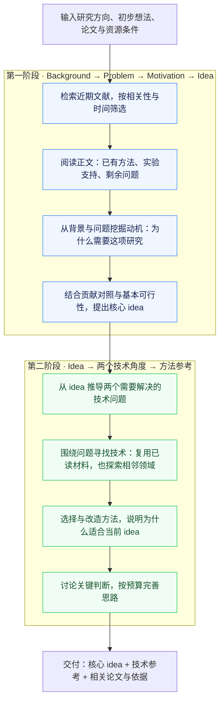

# Research-idea

## 1. 我们的目的

**帮助研究者从 LLM、NLP、Agent 的相关文献中，形成一个值得研究、有实质新意、具备合理实现思路的 idea。**

你提供研究方向，也可以补充初步想法、参考论文和资源条件。系统阅读文献，理解已有工作解决了什么、还留下什么重要问题，再把背景、问题、动机和核心想法连成一条有说服力的论证。

最终内容直接回答：**新问题是什么、为什么重要、idea 怎样解决它。** 第一部分是核心研究 idea；第二部分围绕它提出两个技术角度，给出可借鉴的方法及改造理由。默认不展开具体例子和实验计划，也不执行训练或论文写作。

当前版本 **v0.3.0**，支持对话式 CLI、文献检索与正文分析、技术参考、讨论修订、论文链接与原文依据、预算管理和中断恢复。已使用 Codex CLI（`gpt-6.1-sol`、`high`）完成真实主题的端到端运行。

## 2. 找 idea 的核心要求

**以能够支撑 CCF-A 研究的完整思路为构思目标。** 问题的重要性、核心洞见、解决思路和预期贡献要一起成立；说明这项研究会让我们理解什么新现象、获得什么新能力，或突破什么关键限制。

**Motivation 是整个 idea 的核心。** 从背景的实际需要和已有工作留下的问题中，挖掘出“为什么需要开展这项研究”：现有办法依赖什么条件，为什么仍留下重要困难，因此需要理解什么关系或实现什么能力，以及做到之后为什么有意义。先把这项研究的理由讲清楚，再提出回应它的 idea。即使暂时拿掉具体技术的名字，读者仍应能理解这项研究为什么值得做。

1. **有意义、有新意，而且环环相扣。** 从背景中的实际需要出发，说明已有工作做到了什么、还存在什么问题、可能为什么发生、现有办法为什么仍不足，由此推导研究动机，再提出针对这个动机的 idea。问题本身要值得研究，即使后来需要更换解释或方法，其价值也应成立。新增模块、小幅提升、换一个场景或重新描述 trade-off，本身不足以构成实质贡献。
2. **看论文细节，判断具体贡献有没有重叠。** 阅读方法、实验条件和结果，区分作者的主张与实际支持的结论。比较已有方法完整的信息获取、主动探索和更新能力；相似标题、同类技术或相关主题不会直接否定 idea。方法可以借鉴，关键是新问题、新解释或新能力是否已经被回答，以及剩下的差异为什么重要。
3. **把能提前发现的可行性问题想清楚。** 说明谁能改变什么、需要哪些数据与信号、信息在什么时候可获得，以及核心思路怎样作用于问题。基本实施条件在第一阶段就推演；第二阶段再寻找适合的技术，包含其他计算机领域的可迁移方法。让方法有合理的实现路径，同时把研究假设和已有事实说清楚。

这些要求直接进入现有的选题、构思、技术设计和讨论修订。大胆提出想法，在比较中改进薄弱环节；不额外增加评分表、审批步骤或先完成实验的要求。CCF-A 是研究目标，生成结果的价值仍需后续研究检验。

## 3. 整体框架



**第一阶段到提出 idea 结束。** 阅读与构思时就完成动机、贡献对照，形成 Background → Problem → Motivation → Idea 的连续解释。

**第二阶段服务于这个 idea 的实现。** 先明确两个互补的技术问题，再寻找方法，解释“借鉴什么、为什么适用、怎样为当前目的改造、两个角度如何共同起作用”。技术探索可以重新检索文献，也可以跨领域寻找思路。

控制器组织检索、阅读和模型调用；八个内置研究 skill 按阶段提供分析指导。阅读者、设计者和讨论者通过论文分析卡、idea 与逐条回应协作，沿用项目选择的模型和预算。运行状态保存在 SQLite，报告输出为 Markdown 和 JSON。详见 [工作流](docs/workflow.md)、[架构](docs/architecture.md)与[开源思路借鉴](docs/sources.md)。

## 4. 安装与启动 CLI

需要 **Python 3.11+**，推荐 Linux/macOS。使用 Codex 后端时，先在本机安装并登录 Codex CLI；Research-idea 沿用它的认证和账户配置。

### 安装

```bash
git clone https://github.com/ghh1125/Research-idea.git
cd Research-idea
python3 -m venv .venv
source .venv/bin/activate
python -m pip install -e .

research-idea doctor
```

PDF 正文提取需要 Poppler 的 `pdftotext`。macOS 可运行 `brew install poppler`；Ubuntu/Debian 可运行 `sudo apt-get install poppler-utils`。`doctor` 会检查本地命令是否可用。

### 打开对话窗口

```bash
research-idea chat --project ./research-projects/my-idea \
  --backend codex --model gpt-6.1-sol --reasoning-effort high
```

打开后输入研究方向，与模型讨论；准备好后输入 **`/run`** 开始研究。再次运行相同命令会打开原项目，保留对话、设置和进度。

安装环境已激活时，也可以直接运行 `research-idea`，新建一个对话项目。希望逐项选择主题、模型、论文和预算时，运行 `research-idea launch`。

### 一条命令直接开始研究

```bash
research-idea start "如何设计帮助 LLM agent 持续学习的交互环境" \
  --project ./research-projects/agent-environment \
  --backend codex --model gpt-6.1-sol --reasoning-effort high \
  --literature-preset ai-recent \
  --max-papers 6 --max-candidates 1 --max-rounds 2 \
  --max-calls 80 --max-seconds 6600 --timeout-s 1200
```

只想体验离线流程时，运行 `research-idea demo --project ./research-projects/demo`。Demo 使用合成材料与确定性后端，不调用真实模型。

## 5. CLI 操作与参数设置

### 在窗口中讨论与研究

直接输入文字会与模型讨论，第一条消息默认成为研究主题。**`/run` 才开始正式检索与构思。** 运行时隐藏输入框，显示步骤输出和旋转指示；Ctrl+C 停止并保存进度，结束后恢复输入。每一步先显示主要发现，`/details` 可以展开完整分析。

| 过程标签 | 展示内容 |
| --- | --- |
| `[search]` / `[paper]` / `[read]` | 在找什么、选择了哪篇论文、正在阅读什么 |
| `[skill]` / `[analysis]` | 当前采用的分析方法与主要发现 |
| `[thinking]` | 等待模型回复；底部旋转指示与本步用时持续刷新 |
| `[concept]` | 第一阶段的背景、问题、动机与 idea |
| `[design]` / `[review]` | 两个技术角度、可借鉴方法与讨论修订 |
| `[evidence]` / `[idea]` | 论文依据与最终研究 idea |

论文引用直接显示**标题、文章链接和原文位置**，不需要查后台证据编号。当前显示的是步骤进展与分析结果，不是逐 token 的模型思考流。

### 最常用的操作

| 想做什么 | 在窗口中输入 |
| --- | --- |
| 看使用介绍 / 全部命令 | `/intro` / `/help`，介绍入口常驻底部 |
| 选择模型 / 思考强度 | `/model` / `/reasoning`，打开选择菜单 |
| 直接设置模型与强度 | `/model gpt-6.1-sol`，然后 `/reasoning high` |
| 沿用 Codex 配置 | `/model inherit` / `/reasoning inherit` |
| 看模型目录 / 登录方式 | `/models` / `/account` |
| 查看或修改研究主题 | `/topic` / `/topic 新方向` |
| 导入多行研究说明 | `/input /path/to/brief.txt` |
| 添加已有论文 | `/papers /path/to/paper.pdf`，支持带引号的空格路径 |
| 保存资源条件 | `/constraints 单张24GB GPU，两周，允许小规模微调` |
| 开始或恢复研究 | `/run`；运行时按 Ctrl+C 停止 |
| 查看方案 / 论文依据 | `/report` / `/evidence`；`/evidence 1` 展开指定依据 |
| 看详细过程 | `/details` 展开上一步，`/details on` 持续显示完整输出 |
| 查看设置 / 进度 | `/config` / `/status` |
| 新建研究 / 打开旧项目 | `/new 新方向` / `/open 项目目录` |
| 退出 | `/exit` 或 Ctrl+D |

Enter 发送；先按 Esc 再按 Enter 换行；Tab 补全命令；↑↓ 浏览输入历史。多行粘贴作为一条输入处理。

### 文献范围与日期

| 设置 | 命令 |
| --- | --- |
| 近期会议 + CS arXiv | `/scope ai-recent` |
| 只使用本地资料 | `/scope local` |
| 查看 / 调整日期窗口 | `/date` |
| 动态窗口：技术 12 个月、动机对照 6 个月 | `/date rolling 12 6` |
| 固定发表日期范围 | `/date fixed 2025-01-01 2026-10-23` |
| 查看 / 选择会议 | `/venues` / `/venues ACL EMNLP COLM ICLR` |

动态窗口会按运行当天重新计算。新项目默认使用 CS 范围；背景与技术探索看近 12 个月，第一阶段动机与贡献对照关注近 6 个月。已读资料及显式导入的经典论文仍可使用。

`ai-recent` / `ai-recommended` 的会议范围包含 **NeurIPS、ICML、ICLR、ACL、EMNLP、NAACL、COLM、AAAI、IJCAI、AAMAS、KDD、ICDM、ICDE、SIGMOD、VLDB、ACM MM、CVPR、ICCV、SIGIR、WWW**。先按主题、相关性与时间筛选，再决定精读哪些论文；会议名单不代表每篇都要阅读。已有项目可用 `/scope ai-recent` 更新范围，完整分级与来源见 `research-idea venues`。

### 预算与恢复

| 设置 | 命令 | 新建对话项目的默认值 |
| --- | --- | --- |
| 每个查询召回的论文元数据数 | `/budget search_results_per_query 20` | 20 |
| 全流程精读上限 | `/budget max_papers 6` | 6，通常第一阶段最多 3 篇，第二阶段补充最多 3 篇 |
| Idea 数量 | `/budget max_candidates 1` | 1 |
| 方案讨论轮数 | `/budget max_rounds 2` | 2，初版加一次修订 |
| 模型调用上限 | `/budget max_calls 80` | 80 |
| 累计运行时间（秒） | `/budget max_seconds 6600` | 110 分钟 |
| 单次模型调用超时（秒） | `/budget timeout_s 1200` | 20 分钟 |

底部的 **“调用 3/80”表示本项目累计使用了 3 次模型调用，上限为 80 次**，不是论文数量。讨论、研究及结构化输出修复共享预算；达到预算后可以提高上限并继续。

清空输入、退出或重新打开项目都会保留累计用量。**`/new` 才开始计数为零的新研究**，并沿用当前模型、日期与预算设置。原项目保留，可用 `/open` 返回。

### 命令行参数与项目配置

| 参数 | 用途 |
| --- | --- |
| `--project PATH` | 指定项目目录，配置、材料和结果保存于此 |
| `--backend codex --model MODEL_ID` | 选择后端和模型 |
| `--reasoning-effort high` | 设置 Codex 思考强度；`inherit` 沿用原配置 |
| 主题位置参数 / `--topic-file ./brief.txt` | 直接输入主题或使用 UTF-8 文件，二选一 |
| `--papers ./papers paper.pdf` | 导入 PDF、TXT、Markdown、论文 JSON 或目录 |
| `--constraints "资源条件"` | 记录设备、时间和数据等条件 |
| `--literature-preset ai-recent` | 使用近期会议与 CS arXiv |
| `--date-mode rolling --strategy-months 12 --novelty-months 6` | 设置动态检索窗口 |
| `--since YYYY-MM-DD --until YYYY-MM-DD` | 设置固定日期范围 |
| `--venues ACL COLM` / `--arxiv-categories cs.CL cs.AI` | 指定会议或 arXiv 分类 |
| `--max-papers` / `--max-candidates` / `--max-rounds` | 设置论文、idea 与讨论轮数上限 |
| `--max-calls` / `--max-seconds` / `--timeout-s` | 设置调用与时间上限 |
| `--skill /path/to/SKILL.md` | 附加本地 skill，可重复传入；内置八个 skill 默认启用 |
| `--no-search` | 使用已有资料，跳过联网检索 |
| `--setup-only` | 仅保存配置并导入资料，暂不调用模型 |

上表汇总不同命令的参数；完整支持范围用 `research-idea start --help` 或 `research-idea chat --help` 查看。设置保存在项目的 `research.toml` 中，`resume` 会沿用它们。例如：

```toml
backend = "codex"
model = "gpt-6.1-sol"
reasoning_effort = "high"
max_papers = 6
max_candidates = 1
max_rounds = 2
max_calls = 80
max_seconds = 6600
timeout_s = 1200
```

```bash
research-idea resume --project ./research-projects/my-idea
research-idea status --project ./research-projects/my-idea
```

主要结果在 `outputs/report.md`，结构化结果在 `outputs/report.json`，论文分析卡在 `outputs/papers/`。对话、检查点和累计用量保存在项目内；成功任务可以缓存，材料或相关设置变化时重新计算。文献导入格式、skill 选择、引文处理和恢复细节见 [进阶使用](docs/advanced-usage.md)。

## 6. 可以绑定的模型与后端

项目不固定某一个模型。**选择后端，再指定该后端和账户实际支持的模型 ID；同一轮研究默认沿用同一个后端与模型。**

| 后端 | 如何选择模型 | 认证与适用范围 |
| --- | --- | --- |
| **Codex CLI**：`--backend codex` | `--model MODEL_ID` 或窗口中的 `/model`；留空则继承 Codex 配置 | 沿用本地 Codex 登录；支持项目内设置思考强度。已实跑 `gpt-6.1-sol` + `high` |
| **Claude Code CLI**：`--backend claude` | `--model MODEL_ID`；留空则继承 Claude CLI 配置 | 沿用本地 Claude 登录；需要支持适配器参数的 CLI 版本 |
| **OpenAI-compatible API**：`backend = "api"` | 在项目配置中填写服务支持的 `model` | 支持 `/chat/completions` 和严格 JSON Schema 的云服务或本地兼容服务 |
| **Anthropic API**：`backend = "api"` | 指定 `api_provider = "anthropic"` 与支持结构化输出的模型 | 使用原生 `/messages` 协议，通过环境变量提供密钥 |

### Codex 模型与思考强度

```bash
research-idea chat --project ./research-projects/my-idea \
  --backend codex --model gpt-6.1-sol --reasoning-effort high
```

进入窗口后随时通过 `/model` 和 `/reasoning` 调整。程序接受 `none/minimal/low/medium/high/xhigh/max/ultra`，具体可用档位以所选模型和 CLI 为准；`inherit` 表示继承。设置只覆盖本项目的调用，不修改 Codex 全局配置。

`/models` 查看本地模型缓存，`/account` 查看后端、模型、配置档与登录方式。模型缓存不是账户的实时授权列表，实际调用由后端处理。当前思考强度参数仅支持 Codex；切换到其他后端时使用 `--reasoning-effort inherit`。

需要已有 Codex profile 时，启动命令附加 `--codex-profile research`；需要指定可执行文件时附加 `--codex-bin /path/to/codex`。认证由 Codex 管理，Research-idea 不复制登录文件或显示密钥。

### API 模型配置

在项目的 `research.toml` 中设置：

```toml
backend = "api"
api_provider = "openai-compatible"
base_url = "https://api.openai.com/v1"
api_key_env = "RESEARCH_API_KEY"
model = "填写服务支持的模型ID"
reasoning_effort = ""
max_output_tokens = 8192
api_max_tokens_field = "max_completion_tokens"
```

在终端环境中设置 `RESEARCH_API_KEY` 后，运行 `research-idea chat --project 项目目录` 或 `research-idea run --project 项目目录`。密钥通过环境变量读取，配置文件只保存变量名。

使用原生 Anthropic 时，将 `api_provider` 改为 `anthropic`，`base_url` 改为 `https://api.anthropic.com/v1`，`api_key_env` 改为 `ANTHROPIC_API_KEY`，并填写对应模型 ID。详细协议、CLI 兼容要求与本地服务配置见 [后端配置](docs/advanced-usage.md#后端配置)。

目前真实账户验证覆盖 Codex，其余适配器已有协议测试。开发者可运行 `PYTHONPATH=src python -m unittest discover -s tests -v`；自动化测试覆盖 Python 3.11、3.12、3.13。
