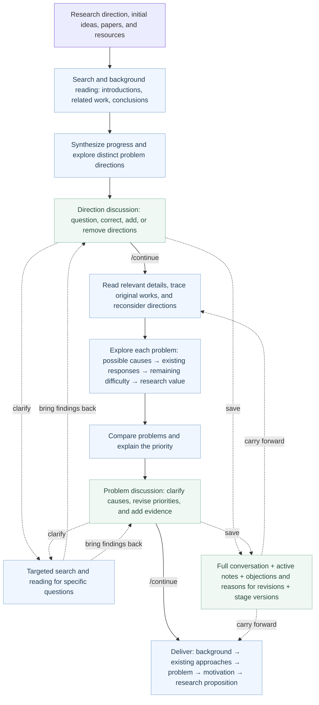

# Research-idea

[](README.zh-CN.md)

## 1. Purpose

**Help researchers find a question worth studying in the LLM, NLP, and agent literature, and clearly explain its background, existing approaches, problem, and motivation.**

Start with a research direction. You can also provide initial ideas, reference papers, and resource constraints. The system surveys the literature, groups the main approaches, examines several distinct and important problems, and discusses them with you before developing a coherent research argument.

The final output focuses on five things: **What does the field need? → What have existing approaches achieved? → Why do important difficulties remain? → Why are they worth studying? → What is the core research proposition?** The proposition states the understanding or capability the research aims to advance. The workflow ends here; it does not proceed to technical designs, implementation proposals, or experiment plans.

The current version, **v0.6.0**, includes a conversational CLI, literature search and full-text analysis, two discussion pauses, `/continue` to advance, persistent conversation memory with message sources, paper links and source evidence, budgets, and resumable runs. This release makes repeated discussion easier: each reply shows what actually changed in the saved draft, follow-up questions recall earlier feedback using the current discussion context, and every CLI command has usage help. See the [changelog (Chinese)](CHANGELOG.md).

**Language:** this README is available in English and [Simplified Chinese](README.zh-CN.md). The current CLI interface and generated research reports primarily use Chinese; an English README does not change the application's language.

## 2. What makes a good research idea?

**Motivation is central; finding the right problem comes first.** The goal is a meaningful question that could support research at a leading CCF-A venue: explaining an important phenomenon, identifying an obstacle to the field's original goal, or pursuing a valuable new capability. An extra module, a small score improvement, or a restated trade-off does not establish significance on its own. A technique should not dictate the question simply because it is easy to implement.

1. **Start with the broader need and the main approaches, then derive the problem.** Preserve the user's research goal. Read introductions, related work, methods, and results to understand the major lines of work. Representative papers explain how these approaches operate and what they have achieved; their datasets do not automatically define the scope of the new research.
2. **Derive important problems in two ways.** Either an important need remains unmet because existing approaches, even when working as intended, cannot overcome a key obstacle; or approaches solve an earlier problem but introduce new difficulties as they are used or developed. In both cases, explain how the difficulty arises, what it affects, and why ordinary improvements may not resolve it. Acknowledge prior contributions before explaining what remains; do not manufacture motivation by dismissing those contributions.
3. **Compare genuinely different problems and explain the priority.** Examine the strongest existing responses, the causes of the remaining difficulty, its effect on the original goal, and its research value for each candidate. Favor insight and significance rather than ease of implementation. Alternative directions and their reasoning remain available for discussion.
4. **Compare contributions in detail, rather than rejecting an idea because a title sounds similar.** Find the closest work and examine its question, conditions, available information, and actual progress. Similar methods can be useful building blocks. What matters is whether the proposed question, explanation, or capability is already covered, and why the difference is meaningful. Distinguish authors' claims from the conclusions their experiments support.
5. **Allow bold, reasonable hypotheses and explain their reasoning.** A new difficulty need not already be documented in a paper. Derive when it might arise from existing mechanisms, explain why it matters, and develop a research proposition from it. Make the assumptions and supporting facts clear. Address foreseeable issues such as unavailable information or contradictory objectives during discussion; an instruction to “make the model identify it accurately” does not explain how the central difficulty can be overcome.

The current workflow writes the background, existing approaches, problem, and motivation in **detailed, plain Chinese**. Readers should understand what cannot yet be done, why existing approaches may still encounter the difficulty, and why it deserves attention without opening every paper or repeatedly looking up terminology. These principles guide search, reading, independent analysis, and discussion directly; they do not add scorecards or approval gates.

## 3. Workflow



**Two pauses let you revise the reasoning before the final proposition.** The first discussion checks whether the direction has become too narrow or overlooks a more important question. After `/continue`, the system examines each problem in depth and compares their significance and priority. The second discussion focuses on the problems themselves: whether the difficulty matters, whether its causes make sense, and why existing approaches might still leave it unresolved. Another `/continue` produces the motivation and research proposition from the current discussion. Ordinary messages stay within the discussion rather than advancing automatically.

**Build an understanding of the field before reading problem-specific details.** Before the first discussion, each available full text receives one scoped background read, prioritizing the introduction, related work, and conclusion. Discussion starts without requiring a complete analysis card and audit for every paper. After `/continue`, reading focuses on the closest work's methods, information sources, conditions, and results. It considers strong existing responses as well as potential new difficulties, rather than only collecting support for a hypothesis.

**Explain how the difficulty arises.** “Some information is missing, so performance suffers” is not a complete research problem. The workflow asks why the gap arises in normal use, why it might remain after existing approaches acquire information, receive feedback, or update, and how it obstructs the original goal. Bold, reasonable hypotheses are welcome; the focus is a clear argument rather than a score threshold.

**Synthesize across papers and compare competing explanations.** Alongside individual paper analyses, the system records what major approaches rely on, what progress they have enabled, and what might happen when their conditions change. These observations inform problem discovery. Deeper analysis compares possible causes of the same difficulty and existing responses to each, explaining how different causes would change the research focus. It does not force a claim that every approach shares the same weakness when the sources do not support one.

**New reading can change the question; citations can lead to original work.** When targeted reading adds material, the system reconsiders the directions once, allowing rewording, merging, or replacement while recording why. This extra call is skipped when no new reading was added. Reading plans also inspect related work and references for relevant original papers: already discovered papers are reused, and missing ones are searched by full title. Citation tracing and ordinary follow-up search share a limit of two additional papers per direction; older foundational work can use the background tracing window.

Search favors short concepts and synonyms. If a long natural-language arXiv query returns few results, the system makes one keyword expansion within the same field and date filters, then ranks by relevance. Explicit query syntax and full-title queries are preserved.

**Discussions leave records that later steps can use.** The complete conversation is saved. Ongoing research requirements, temporary instructions for the current stage, and assistant suggestions are handled separately. Later calls receive active notes, their original messages, relevant history, and the current discussion version, so earlier corrections are not simply displaced by recent messages. These records survive model changes and CLI restarts.

Specific objections, reasons for changed judgments, and conditions for revisiting a question are also recorded. Revisions update the active record while retaining earlier versions; assistant judgments are not treated as user decisions. Use `/memory` to inspect these records. Built-in skills load the guidance needed for the current task—synthesis, causal comparison, reconsideration, discussion, or writing—instead of supplying every stage's instructions at once.

The controller coordinates search, reading, and staged analysis. Research skills guide background synthesis, problem discovery, contribution comparison, and argument development. State is stored in SQLite, with Markdown and JSON outputs. See the [workflow](docs/workflow.md), [architecture](docs/architecture.md), and [open-source inspirations](docs/sources.md) for implementation details; these documents are currently in Chinese.

## 4. Installation and launch

Requires **Python 3.11+ and Git**. For a Codex or Claude backend, install and sign in to the corresponding CLI in the same system environment first.

Follow the instructions for your operating system once, then launch with `research-idea`. [pipx](https://pipx.pypa.io/latest/how-to/install-pipx.html) manages an isolated environment for the command, so you do not need to activate a virtual environment or enter the repository each time.

### macOS

Install Homebrew first, then run:

```bash
brew install pipx poppler
git clone https://github.com/ghh1125/Research-idea.git
cd Research-idea
pipx install --editable .
pipx ensurepath
```

### Linux (Ubuntu / Debian)

Check that `python3 --version` is 3.11 or newer. On Ubuntu 24.04+ or Debian 12+:

```bash
sudo apt update
sudo apt install git python3-venv pipx poppler-utils
git clone https://github.com/ghh1125/Research-idea.git
cd Research-idea
pipx install --editable .
pipx ensurepath
```

On Fedora, install the tools with `sudo dnf install git pipx poppler-utils`, then use the same clone and pipx commands. For **WSL2** on Windows, follow the instructions for your Linux distribution and run both the project and the selected model CLI inside WSL.

### Windows (PowerShell)

Install Python 3.11+ with the `py` launcher and Git, then run in PowerShell:

```powershell
py -3 -m pip install --user pipx
git clone https://github.com/ghh1125/Research-idea.git
cd Research-idea
py -3 -m pipx install --editable .
py -3 -m pipx ensurepath
```

PDF reading requires Poppler's `pdftotext`. On Windows, install the [Poppler package from WinGet](https://github.com/microsoft/winget-pkgs/tree/master/manifests/o/oschwartz10612/Poppler):

```powershell
winget install --id oschwartz10612.Poppler --exact --source winget
```

The macOS and Linux instructions already include the PDF tools. On Windows, make sure both your model CLI and `pdftotext` are available from the same terminal.

### Check the installation

On all three platforms, **close and reopen your terminal** after installation so the updated command path takes effect. Then run:

```bash
research-idea --version
research-idea doctor
```

`doctor` checks whether the model CLIs and `pdftotext` are available. If `research-idea` is still not found, run `pipx ensurepath` on macOS/Linux or `py -3 -m pipx ensurepath` on Windows, then reopen the terminal.

This is an editable installation from the local repository, so keep the repository directory. An existing working virtual environment or local launch command can still be used without reinstalling. For a development virtual environment, see [advanced usage (Chinese)](docs/advanced-usage.md#虚拟环境安装).

### Upgrade to v0.6.0

Close the running Research-idea window, then run these commands **inside your existing repository directory**.

macOS / Linux:

```bash
git pull --ff-only
pipx reinstall research-idea
research-idea --version
```

Windows (PowerShell):

```powershell
git pull --ff-only
py -3 -m pipx reinstall research-idea
research-idea --version
```

The version should show `0.6.0`. If you installed into a virtual environment, activate it and replace the pipx command with `python -m pip install -e .`. Launch `research-idea` again and use `/open PROJECT_DIR` to continue an existing discussion; your project stores its conversation, notes, and progress.

### Open the conversation window

From your terminal, run:

```bash
research-idea
```

This opens the conversation window and creates a project under `research-projects/` in the current directory. Use `/model` to choose a model, `/reasoning` to set reasoning effort, and `/intro` for an introduction. Enter your research direction, discuss it, then use **`/run`** to begin the literature review. The system pauses first for direction discussion, then for discussion of the deeper problem analysis. Use **`/continue`** at each pause to advance toward the motivation and research proposition.

To open a specific project or choose a model at launch:

```bash
research-idea chat --project ./research-projects/my-idea --backend codex --model gpt-6.1-sol --reasoning-effort high
```

Running the same `--project` command reopens that project's conversation, settings, and progress. You can also use `/open PROJECT_DIR` inside the window.

For a guided setup of the topic, model, papers, and budget, run `research-idea launch`.

### Start a research run directly

```bash
research-idea start "How can interactive environments help LLM agents keep learning?" \
  --project ./research-projects/agent-environment \
  --backend codex --model gpt-6.1-sol --reasoning-effort high \
  --literature-preset ai-recent \
  --max-papers 6 --max-candidates 1 \
  --max-calls 80 --max-seconds 6600 --timeout-s 1200
```

To try the offline workflow, run `research-idea demo --project ./research-projects/demo`. The demo uses synthetic materials and a deterministic backend, without calling a real model.

## 5. CLI commands and settings

### Discuss and research in the window

Plain text starts a discussion with the model; the first message becomes the research topic by default. **`/run` starts the literature review and pauses after proposing distinct problem directions.** Ask questions, make corrections, or add directions. The first `/continue` triggers deeper analysis and comparison, then pauses for problem discussion. The second `/continue` develops the research proposition from the current version. The footer shows the current stage and what comes next.

While a task runs, the input box is hidden and step output appears with a spinner. Ctrl+C stops the task and saves progress; input returns when the task pauses or completes. Each step shows its main findings first. Longer analyses retain the opening context and final selection in the compact view; `/details` expands the full output. Asking “why?” does not automatically advance the workflow.

| Tag | What it shows |
| --- | --- |
| `[search]` / `[paper]` / `[read]` | Search targets, selected papers, and current reading |
| `[skill]` / `[analysis]` | The analysis approach and main findings |
| `[thinking]` | Waiting for the model's response; the footer keeps updating the spinner and elapsed step time |
| `[direction]` | Direction discussion after the initial review; waiting for `/continue` to deepen the problems |
| `[problem]` | Discussion after deeper analysis; waiting for `/continue` to develop the research proposition |
| `[concept]` | Organizing the background, existing approaches, problem, motivation, and research proposition |
| `[history]` | Original conversation messages with message IDs |
| `[update]` | Changes actually saved this turn, retained content, and the current focus; independent of the model's verbal assurances |
| `[evidence]` / `[idea]` | Paper evidence and the final research proposition |

Paper citations in the main window show **titles and article links** directly. There is no need to look up internal evidence IDs. `/evidence` expands source quotations, page numbers, and locations. The display shows progress and analysis results, not a token-by-token stream of the model's internal reasoning.

### All conversation-window commands

**Slash commands in the conversation window and `research-idea` subcommands in your system terminal are separate interfaces.** Enter the commands below in the conversation window. Ordinary text starts a discussion; reading help does not call a model or change settings.

```text
/help                  Browse commands by purpose
/help date             Read date parameters and examples
/help budget           Read budget keys and units
/date --help           Read help without changing dates
/help all              Expand the complete command reference
```

Every command supports `/help COMMAND`, `/COMMAND --help`, and `/COMMAND -h`. Tab completion also shows its purpose. Square brackets mean optional arguments; a vertical bar means choose one. Do not type those notation characters.

| Command | Purpose | Examples |
| --- | --- | --- |
| `/intro` | Read the guided introduction from topic entry to the research proposition. | `/intro` |
| `/help [command\|all]` | Browse all commands or read one command’s parameters and examples; does not call a model. | `/help date`<br>`/help /budget`<br>`/help all` |
| `/topic [direction]` | View or set the topic before research starts; use /new to change topics after tasks exist. | `/topic`<br>`/topic Multi-agent collaboration` |
| `/input PATH` | Send a UTF-8 text file (up to 128 KiB) as one discussion message. Calls the model. | `/input ./brief.txt` |
| `/constraints [text]` | View resource constraints, or replace them with new text for later research. | `/constraints One 24GB GPU, two weeks` |
| `/run [direction]` | Start research or resume saved progress. An optional direction sets the topic for a new project. | `/run`<br>`/run Multi-agent collaboration` |
| `/continue` | Advance from direction discussion to deeper comparison, or from problem discussion to the final proposition. | `/continue` |
| `/stop` | Stop the active task while keeping completed work. While input is hidden, press Ctrl+C instead. | `/stop` |
| `/problems [detail]` | Review the current direction/problem discussion; detail expands its full argument. | `/problems`<br>`/problems detail` |
| `/model [MODEL_ID\|inherit]` | Open the model menu or set a supported model ID; inherit removes the project override. Does not switch backends. | `/model`<br>`/model gpt-6.1-sol`<br>`/model inherit` |
| `/reasoning [level\|inherit]` | Open the reasoning menu or set Codex reasoning effort; support depends on the model. Other backends use inherit. | `/reasoning`<br>`/reasoning high`<br>`/reasoning inherit` |
| `/models` | Read the local Codex model catalog and recorded reasoning levels; not a live account-access check. | `/models` |
| `/account` | Inspect backend, model, profile, and sign-in method; does not expose keys or query live balance. | `/account` |
| `/papers [PATH…]` | List saved papers and full-text status, or import PDF/TXT/Markdown/JSON files and directories without model reading. | `/papers`<br>`/papers "./my papers/paper.pdf" ./notes.md` |
| `/scope [ai-recent\|local\|START END]` | View scope, restore the recent-literature preset, disable automatic search, or set fixed dates. | `/scope`<br>`/scope ai-recent`<br>`/scope local`<br>`/scope 2025-01-01 2026-10-23` |
| `/date [operation arguments…]` | View/edit arXiv windows and conference editions; fixed dates also set conferences to window mode. | `/date`<br>`/date rolling 12 6`<br>`/date fixed 2025-01-01 2026-10-23`<br>`/date conference latest`<br>`/date conference window` |
| `/venues [PRESET or VENUES]` | View or replace selected venues. Does not re-enable search after /scope local; use /scope ai-recent first. | `/venues`<br>`/venues ACL EMNLP COLM ICLR`<br>`/venues core-astar-ai-2026` |
| `/status` | Show the current project, stage, cumulative usage, paper counts, and next step. | `/status` |
| `/report` | Read the saved research proposition without rerunning research; use /problems before a final report exists. | `/report` |
| `/evidence [NUMBER or ID]` | List paper evidence, then expand a quotation and its location by its evidence-list number or ID. | `/evidence`<br>`/evidence 1` |
| `/details [on\|off]` | Expand the last analysis, enable full ongoing output, or restore the compact view for this window. | `/details`<br>`/details on`<br>`/details off` |
| `/memory` | Review active research notes, their source messages, objections, and reasons for changed judgments. | `/memory` |
| `/history [keyword]` | View recent original messages or search older messages throughout the project. | `/history`<br>`/history research scope` |
| `/config` | Inspect current model, search, budget, resource, and output settings; does not change them. | `/config` |
| `/budget [KEY INTEGER]` | View limits or change one limit; time values are in seconds. Raising a limit preserves usage. | `/budget`<br>`/budget max_calls 100`<br>`/budget max_seconds 7200`<br>`/budget max_papers 6` |
| `/output [DIRECTORY\|default]` | View/change the result parent directory. Keeps the generated folder name; re-exports existing results and retains old files. | `/output`<br>`/output ~/research-results`<br>`/output default` |
| `/new [direction]` | Create an empty project with inherited settings and zero usage; previous conversation and papers remain in the old project. | `/new`<br>`/new Multi-agent collaboration` |
| `/open PROJECT_DIR` | Open a project and restore settings, conversation, and pause state; a new path initializes a project. Use the project directory, not the report folder. | `/open ./research-projects/my-idea` |
| `/exit (alias /quit)` | Exit, stopping any active task and preserving records. Ctrl+D also exits. | `/exit`<br>`/quit` |

Enter sends a message. Press Esc, then Enter to insert a newline. Tab completes commands; ↑/↓ browse input history. Multiline pasted text is handled as a single input.

The complete conversation is stored in the project's SQLite database, with a stable ID for every message. `/history` shows recent original messages, while `/history KEYWORD` searches earlier content across the project. Each discussion updates the active user notes and their source messages. When a decision changes, the old entry is replaced in the active view but remains traceable.

Temporary instructions belong to the discussion in which they were given. `/continue` ends those stage-specific instructions while retaining research scope, resource constraints, and ongoing preferences. Assistant hypotheses do not automatically become user decisions. Later calls receive active notes, their original messages, the current problem version, and relevant earlier conversation—not the entire history in every prompt. The full record remains stored locally.

`/open PROJECT_DIR` restores the pause point and next-step guidance. Closing the window, restarting the CLI, or switching models does not discard these records. Time spent waiting for user input does not count toward the research budget; discussion calls and additional reading do.

The command-line `start/run/resume` commands use automatic completion for new projects. Projects paused in the interactive window retain their discussion state and need `/continue` from that window.

### Refine the same question through multiple discussion rounds

**You do not have to accept the first version. Keep asking questions, adding sources, and correcting the reasoning until the discussion is ready to move forward.** Send feedback as ordinary messages; you do not need to restart `/run` or create a project for each round.

1. **Start the review.** Enter a direction and use `/run`. The system proposes several problem directions and pauses, then pauses again after deeper comparison.
2. **Say what needs to change.** Ask how the problem follows from the background, compare more important questions, examine the closest prior work, or request a clearer explanation. Wait for the reply and follow up. A stage can contain many discussion turns.
3. **Review the current version.** `/problems` shows the working discussion; `/problems detail` expands the argument. Use `/memory` to check which points were retained and `/history KEYWORD` to find original messages. If the model misunderstood you, state what to keep and what to change.
4. **Request supporting reading within the discussion.** Ask it to check the closest paper's actual approach or find literature bearing on a specific judgment. Targeted search and reading are guided by the question and remaining budget, with findings brought back into the discussion.
5. **Use `/continue` when ready.** After direction discussion, it starts deeper comparison; after problem discussion, it develops the final proposition. Ordinary messages—even “keep discussing”—do not advance past the pause.

For example, send the following as separate messages while paused for problem discussion. Wait for each reply, then decide what to ask next:

```text
Why does this problem obstruct the original research goal? Explain it plainly.
You said existing approaches still cannot resolve it. Which approaches, and why does the difficulty remain?
Keep the background, but do not limit the question to one dataset. Compare two other important problems.
Update the working version from our discussion and explain what changed and why.
```

These are ordinary messages you can send directly. Then use `/problems detail` to review the revision and send `/continue` separately when ready. **A question is not approval of the model's recommendation.** The system may explain or revise the problems and priorities; later steps use the current version.

**You can revise a completed proposition too.** Send new feedback to reopen problem discussion. Review the working draft with `/problems`, then use `/continue` to update the final proposition and `/report` to read it. There is no need to restart the entire literature review.

**See what actually changed after each reply.** The `[update]` notice compares successfully saved versions to show changes to the question, background, priority, or research notes, along with retained content. If nothing was changed, it says so; a reply saying “updated” is not enough. The window shows a short notice, `/memory` expands the latest changes, and `/problems detail` shows the working draft. Failed calls do not publish partial changes.

**Vague follow-ups use the current discussion to find earlier messages.** For a message such as “that earlier explanation is wrong,” retrieval also considers the current problem and the latest assistant reply. Explicit keywords retain priority. At most six earlier messages are added; replaced or withdrawn requirements remain marked as such, and assistant replies serve only as search cues. Both change notices and historical retrieval run locally without additional model calls.

**To pick up later, reopen the same project.** Find its path with `/status`, then use `/open PROJECT_DIR` or `research-idea chat --project PROJECT_DIR`. Original messages, active notes, and discussion versions are preserved. Use `/new` when starting a separate topic. Discussion turns consume model calls, and additional reading can require more; time spent waiting for your reply does not count toward runtime.

### Literature scope and dates

| Setting | Command |
| --- | --- |
| Recent conferences + CS arXiv | `/scope ai-recent` |
| Local materials only | `/scope local` |
| View / adjust arXiv dates and conference editions | `/date` |
| Rolling arXiv windows: 12 months for background and approaches, 6 for motivation comparison | `/date rolling 12 6` |
| Latest publicly available conference edition (default) | `/date conference latest` |
| Apply the date window to conferences too | `/date conference window` |
| Fixed publication date range for all sources | `/date fixed 2025-01-01 2026-10-23` |
| View / choose conferences | `/venues` / `/venues ACL EMNLP COLM ICLR` |

**Conference editions and arXiv dates are handled separately.** By default, arXiv windows move with the run date: 12 months for background and existing approaches, and 6 months for motivation and contribution comparison, restricted to computer science. For each conference, the system uses the latest edition with publicly available or indexed papers. If the current edition is not yet available, it falls back to the previous one rather than excluding it because the conference cycle exceeds six months. Different conferences may use different years. Relevance still determines what gets read.

**For the same research question, newer conference editions take priority.** For example, a 2026 edition is preferred over 2025; older papers can still supply essential methods, context, and comparisons. Ranking uses verified conference years rather than mistaking an earlier arXiv upload for the conference date. The CLI shows the paper title, conference edition, and link together.

**If a full-text download fails, the system looks for a public version.** It first uses the conference's actual PDF link. If that still fails, it searches arXiv by the full title and checks the title and known authors before reading a matching preprint. The report retains the conference metadata and identifies the version and source actually read.

`/date fixed` applies the specified range to both conferences and arXiv. You can then run `/date conference latest` to select the latest public edition available by the cutoff date. `/scope ai-recent` restores the default of latest conference editions plus rolling arXiv windows. Previously read materials and explicitly imported foundational papers remain usable.

The `ai-recent` / `ai-recommended` presets include **NeurIPS, ICML, ICLR, ACL, EMNLP, NAACL, COLM, AAAI, IJCAI, AAMAS, KDD, ICDM, ICDE, SIGMOD, VLDB, ACM MM, CVPR, ICCV, SIGIR, and WWW**. Papers are screened by topic, relevance, and recency before deeper reading; inclusion in the venue list does not mean every paper is read. Update an existing project's scope with `/scope ai-recent`. Run `research-idea venues` for the full classifications and sources.

### Estimated time and model calls

For an initial selection of **about 4–6 papers, deeper comparison of 2–3 problems, and one research proposition**, allow roughly the following, excluding the time you spend reading and replying:

| Stage or resource | Estimate |
| --- | --- |
| Before the first direction discussion (4–6 papers) | **About 10–25 minutes and 7–9 main calls** |
| Complete automated research and synthesis | **About 30–90 minutes** |
| Total model calls | **About 20–45** |

These are planning estimates. Before the first discussion, the main steps are search planning, screening, one background read per paper, and direction exploration. Three problems typically involve six main analysis calls: one exploration, three individual deep dives, one comparison, and one final proposition, plus search planning and reading calls. Downloads, reasoning effort, model speed, additional reading, and retries can extend the total.

An ordinary discussion turn usually adds one model call. A turn requiring literature may also need search planning, reading, and updated analysis. Each problem or specific follow-up question selects a small number of additional papers as needed, usually at most two. All calls share the overall budget. Successful checkpoints are reused when resuming.

Full texts are read in selected sections as needed; idea development uses the resulting analyses and source evidence. Search request logs and section indexes are summarized in the ideation context, while full indexes, locations, and records remain in the project for targeted reading. Source quotations, applicable conditions, and citation locations are preserved. Reading summaries avoid repeated explanations; use `/details` for full analysis and `/evidence` for full evidence. `[context]` shows input characters, not tokens or the account's context limit.

**Estimates are different from budget limits.** The defaults of 80 calls and 110 minutes are adjustable cumulative ceilings, not a fixed duration or a target to exhaust. To allow two hours, set `/budget max_seconds 7200`. If a budget runs out, raise the limit and use `/run` to continue.

### Budgets and recovery

| Setting | Command | Default for a new chat project |
| --- | --- | --- |
| Paper metadata results per query | `/budget search_results_per_query 20` | 20 |
| Initial reading selection | `/budget max_papers 6` | 6; usually about 4 are selected first, with targeted follow-up reading governed by the total budget |
| Number of priority problems | `/budget max_candidates 1` | 1; compare different problems before choosing a focus |
| Model call limit | `/budget max_calls 80` | 80 |
| Cumulative runtime in seconds | `/budget max_seconds 6600` | 110 minutes |
| Timeout per model call in seconds | `/budget timeout_s 1200` | 20 minutes |

The footer's **“调用 3/80” means the project has used 3 model calls out of a limit of 80**, not that it has read three papers. Discussion, research, structured-output repair, and failed retries share the budget. You can raise the limit and continue after reaching it.

Clearing input, exiting, or reopening a project preserves cumulative usage. **`/new` starts a new research project with zero usage**, inheriting the current model, date, and budget settings. The previous project remains available through `/open`.

### Errors and retries

Model service errors are shown by category: `[network]` for connection problems, `[timeout]`, `[api]` for request errors, `[model]` for unavailable or unauthorized models, `[auth]` for authentication, `[quota]` for insufficient balance or quota, `[rate_limit]`, and server errors. Quota and rate-limit errors are distinguished using the provider's response.

**After the first failure, the system retries every 30 seconds, up to 10 retries—11 attempts in total.** `[retry]` shows the reason, waiting time, and attempt count. `[recovered]` appears when a retry succeeds, and the current step continues. Retries keep the selected model, reasoning effort, and task materials.

If attempts are exhausted, `[error]` explains the failure and ends the current task, restoring chat input. Completed analyses and progress are retained. Resolve the issue and use `/run` to resume research, or resend a normal chat message. Ctrl+C stops a retry wait. Each attempt counts toward the call budget, and waiting counts toward runtime; the system stops earlier if the remaining budget is insufficient.

### Output location

For a source installation, results are saved automatically under **`idea-TIMESTAMP/` in the Research-idea repository**, for example `idea-20261024-193304-123456/`. This location is used even when you launch `research-idea` from another directory.

```text
/output                       Show the current output location
/output ~/research-results    Change the parent directory
/output default               Restore the default location
```

On Windows, you can use `/output D:\ResearchResults`; quote paths containing spaces. **Only the parent directory is configurable; the timestamped folder name is generated automatically.** Resuming or exporting the same project reuses its folder name. `/new` creates a new timestamped folder under the current output parent. Changing the location re-exports existing results to the new location while keeping the old files; `/report` reads from the new location.

The folder contains `report.md` (the research question and motivation), `report.json` (structured results and discussion records), and `papers/` (paper analysis cards). Configuration, original materials, complete conversation, and SQLite checkpoints stay in the research project directory. Older reports remain readable. For an installation without a source repository, the launch directory is the default; use `/output` to choose a stable location.

### All system-terminal subcommands

Run these in your macOS terminal, Linux shell, or Windows PowerShell, rather than sending them to the research conversation. Replace `TOPIC` with your direction and the example project path with your own.

Every subcommand has a description, argument help, and examples. Use `research-idea --help` for the overview, `research-idea search --help` for search, or `research-idea skills use --help` for skill selection. `-h` is equivalent to `--help`; `--version` prints the installed version. Runtime help currently uses Chinese.

| Subcommand | Purpose | Example |
| --- | --- | --- |
| `chat` | Open the conversation window; running research-idea without a subcommand does the same. | `research-idea chat --project ./research-projects/my-idea` |
| `launch` | Run the guided setup, then start research; --setup-only saves without running. | `research-idea launch` |
| `init` | Initialize the project and topic without calling a model. | `research-idea init "TOPIC" --project ./research-projects/my-idea` |
| `start` | Configure a topic and materials, then run; use chat for interactive discussion pauses. | `research-idea start "TOPIC" --project ./research-projects/my-idea` |
| `run` | Start or continue using project settings; --replan reconsiders directions from current materials. | `research-idea run --project ./research-projects/my-idea` |
| `resume` | Resume from successful checkpoints; interactive pauses still require /continue in chat. | `research-idea resume --project ./research-projects/my-idea` |
| `add` | Import paper files without immediately calling a model to read them. | `research-idea add --project ./research-projects/my-idea paper.pdf notes.md` |
| `search` | Search and save paper records; --full-text also attempts to download full texts. | `research-idea search "multi-agent collaboration" --project ./research-projects/my-idea --limit 10 --full-text` |
| `venues` | List supported conferences, classifications, presets, and sources. | `research-idea venues` |
| `status` | Inspect project stage, task status, and budget usage. | `research-idea status --project ./research-projects/my-idea` |
| `inspect` | Inspect papers, evidence, or legacy candidates; --events shows events, --paper-card reads a given paper’s analysis. | `research-idea inspect --project ./research-projects/my-idea --events` |
| `export` | Re-export saved reports without new research calls. | `research-idea export --project ./research-projects/my-idea --output ./results` |
| `doctor` | Check model CLIs, PDF tools, and optional project configuration without model requests. | `research-idea doctor` |
| `skills` | Manage local research skills using the four subcommands below. | `research-idea skills --help` |
| `skills list` | List discovered local skills; --root adds a discovery directory. | `research-idea skills list` |
| `skills show` | Read one skill’s guidance text. | `research-idea skills show /path/to/SKILL.md` |
| `skills use` | Replace the project’s selected local skills; accepts several and does not run their scripts. | `research-idea skills use --project ./research-projects/my-idea /path/to/SKILL.md` |
| `skills clear` | Clear extra selected skills while preserving the built-in-skill setting. | `research-idea skills clear --project ./research-projects/my-idea` |
| `demo` | Run an offline demonstration with synthetic materials and no real model. | `research-idea demo --project ./research-projects/demo` |

### Command-line options and project configuration

| Option | Purpose |
| --- | --- |
| `--project PATH` | Project directory for configuration, materials, conversation, and checkpoints |
| `--output PATH` | Output parent directory; the generated folder is always named `idea-TIMESTAMP` |
| `--backend codex --model MODEL_ID` | Select the backend and model |
| `--reasoning-effort high` | Set Codex reasoning effort; `inherit` uses the existing configuration |
| Positional topic / `--topic-file ./brief.txt` | Supply a topic directly or through a UTF-8 file; choose one |
| `--papers ./papers paper.pdf` | Import PDF, TXT, Markdown, paper JSON, or a directory |
| `--constraints "Resource constraints"` | Record equipment, time, data, and other constraints |
| `--literature-preset ai-recent` | Use recent conferences and CS arXiv |
| `--date-mode rolling --strategy-months 12 --novelty-months 6` | Set rolling arXiv windows; conference date policy is separate |
| `--conference-policy latest` / `--conference-policy window` | Use the latest public conference edition or filter by the date window |
| `--since YYYY-MM-DD --until YYYY-MM-DD` | Set fixed dates, also applied to conferences unless `--conference-policy latest` is explicit |
| `--venues ACL COLM` / `--arxiv-categories cs.CL cs.AI` | Select conferences or arXiv categories |
| `--max-papers` / `--max-candidates` | Set the initial reading selection and number of priority problems |
| `--max-calls` / `--max-seconds` / `--timeout-s` | Set call and time limits |
| `--skill /path/to/SKILL.md` | Add a local skill; repeatable. Built-in skills load by task stage |
| `--no-search` | Use existing materials without online search |
| `--setup-only` | Save configuration and import materials without calling a model |

Additional search, import, and management options:

| Option | Purpose and applicable command |
| --- | --- |
| `--source` / `--search-source` | Choose arxiv, openalex, or hybrid; --search-source is an alias on research-run commands. |
| `--search-results-per-query 20` | Maximum metadata records per query, not the number of full texts to read. |
| `--cs-only` / `--no-cs-only` | Enable or disable the CS-field restriction; venue filters remain separate. |
| `--fetch-full-text` / `--no-fetch-full-text` | Persist whether full texts are retrieved automatically; enabled by default. |
| `--codex-bin PATH` / `--codex-profile NAME` | Choose the Codex executable or an existing configuration profile. |
| `--skill-root PATH` / `--no-builtin-skills` | Add a local skill discovery directory, or disable built-in skills; --skill-root is repeatable. |
| `--replan` | run/resume: reconsider directions from current materials while preserving conversation. |
| `--kind full_text` / `--kind abstract` / `--kind notes` | add: identify imported content as paper full text, an abstract, or notes. |
| `--limit 10` / `--full-text` | search: limit returned records and optionally attempt full-text downloads. |
| `--events` / `--paper-card` | inspect: view events or the analysis card for a supplied paper ID; mutually exclusive. |
| `--root PATH` | skills list/show/use: additional skill discovery directory; repeatable. |

These tables combine options from different commands. Check `research-idea start --help` or `research-idea chat --help` for each command's supported options. Settings are stored in the project's `research.toml` and reused by `resume`. For example:

```toml
backend = "codex"
model = "gpt-6.1-sol"
reasoning_effort = "high"
conference_policy = "latest"
max_papers = 6
max_candidates = 1
max_calls = 80
max_seconds = 6600
timeout_s = 1200
```

```bash
research-idea resume --project ./research-projects/my-idea
research-idea status --project ./research-projects/my-idea
```

Use `/output` to inspect the result location at any time. Successful tasks can be cached. Changing only the output location does not trigger new model calls; changes to materials or relevant research settings invalidate the corresponding cached work. See [advanced usage (Chinese)](docs/advanced-usage.md) for import formats, skill selection, citation handling, and recovery details.

## 6. Models and backends

The project is not tied to one model. **Choose a backend and a model ID supported by that backend and your account. A research run uses the same backend and model by default.**

| Backend | Model selection | Authentication and requirements |
| --- | --- | --- |
| **Codex CLI**: `--backend codex` | `--model MODEL_ID` or `/model`; omitted values inherit the Codex configuration | Uses the local Codex sign-in and supports project-specific reasoning effort |
| **Claude Code CLI**: `--backend claude` | `--model MODEL_ID`; omitted values inherit the Claude CLI configuration | Uses the local Claude sign-in; requires a CLI version supporting the adapter's arguments |
| **OpenAI-compatible API**: `backend = "api"` | Set the provider-supported `model` in the project configuration | Cloud or local services supporting `/chat/completions` and strict JSON Schema |
| **Anthropic API**: `backend = "api"` | Set `api_provider = "anthropic"` and a model supporting structured output | Uses the native `/messages` protocol with an API key supplied through an environment variable |

### Codex model and reasoning effort

```bash
research-idea chat --project ./research-projects/my-idea \
  --backend codex --model gpt-6.1-sol --reasoning-effort high
```

Use `/model` and `/reasoning` inside the window to change these settings. Accepted values are `none/minimal/low/medium/high/xhigh/max/ultra`; actual support depends on the selected model and CLI. `inherit` uses the existing setting. These overrides affect only calls from the current project, not the global Codex configuration.

`/models` reads the local model cache. `/account` shows the backend, model, profile, and sign-in method. The cache is not a live list of account permissions; the backend determines access when called. Reasoning-effort overrides currently apply only to Codex; use `--reasoning-effort inherit` with other backends.

Add `--codex-profile research` to use an existing Codex profile, or `--codex-bin /path/to/codex` to choose the executable. Codex manages authentication; Research-idea does not copy sign-in files or display secret keys.

### API configuration

In your project's `research.toml`:

```toml
backend = "api"
api_provider = "openai-compatible"
base_url = "https://api.openai.com/v1"
api_key_env = "RESEARCH_API_KEY"
model = "YOUR_SUPPORTED_MODEL_ID"
reasoning_effort = ""
max_output_tokens = 8192
api_max_tokens_field = "max_completion_tokens"
```

Set `RESEARCH_API_KEY` in your terminal environment, then run `research-idea chat --project PROJECT_DIR` or `research-idea run --project PROJECT_DIR`. The key is read from the environment; the configuration file stores only its variable name.

For the native Anthropic API, change `api_provider` to `anthropic`, `base_url` to `https://api.anthropic.com/v1`, and `api_key_env` to `ANTHROPIC_API_KEY`, then choose the corresponding model ID. See [backend configuration (Chinese)](docs/advanced-usage.md#后端配置) for protocol details, CLI compatibility, and local services.

For development, run `PYTHONPATH=src python -m unittest discover -s tests -v`. The automated test matrix covers Python 3.11, 3.12, and 3.13.
