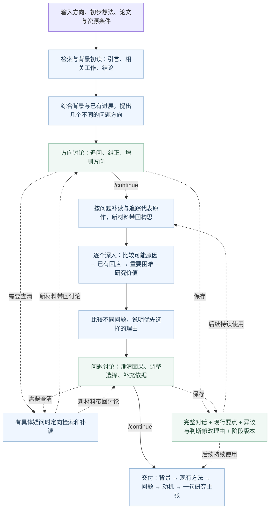

# Research-idea

[](README.md)

## 1. 我们的目的

**帮助研究者从 LLM、NLP、Agent 文献中，找到一个真正值得研究的问题，并把背景、现有方法、问题和动机讲清楚。**

你输入研究方向，也可以补充初步想法、参考论文和资源条件。系统调研文献，归纳解决这个方向的几类主要思路，深入比较不同的重要问题，再和你讨论、修正，最终形成一条连贯的研究论证。

最终内容聚焦五件事：**背景中的需要是什么 → 现有方法已经做到了什么 → 为什么还会遇到重要问题 → 为什么值得研究它 → 一句核心研究主张。** 研究主张说明想推进什么认识或能力。当前流程到这里结束，不继续展开技术路线、实现方案或实验计划。

当前版本 **v0.5.0**，支持对话式 CLI、文献检索与正文分析、方向和问题两处讨论、`/continue` 推进、带出处的持久会话记忆、论文链接与原文依据、预算管理和中断恢复。详见[版本更新](CHANGELOG.md)。

## 2. 找 idea 的核心要求

**Motivation 是核心，问题发现是关键。** 目标是形成能支撑 CCF-A 研究的有意义问题：解释一个值得理解的新现象、发现影响原目标的关键障碍，或提出值得追求的新能力。不能只用新增模块、小幅涨分或重新描述 trade-off 代替研究意义，也不能因为某个技术容易写，就反过来为它寻找问题。

1. **从大背景归纳主要方法，再引出问题。** 保留用户的原始研究目标，综合论文的引言、相关工作、方法和结果，先梳理现有研究的几个主要角度。代表论文用来说明这些思路怎样工作、取得了什么进展；论文使用的数据集不自动成为我们的研究范围。
2. **重要问题只从两个角度推导。** 一是背景中有重要需要，现有主要方法正常发挥后仍跨不过某个关键障碍；二是已有方法解决了原问题，但在使用或发展过程中又暴露新的困难。两者都要讲清楚：困难怎样产生，影响什么，为什么通常的改进仍处理不了。承认已有贡献，再解释它之后的问题，不能靠否定论文的贡献制造动机。
3. **比较几个真正不同的问题，说明为什么优先研究这个。** 每个问题分别深入分析已有方法的有效回应、剩余困难的成因、对原目标的影响和研究价值。优先选择有洞见且影响重要的问题，不把“容易实现”当成首要理由。没选中的方向及其论证仍会保留，讨论时可以切换。
4. **查贡献细节，不因标题相关就否定。** 找到真正最接近的工作，比较它回答的问题、适用条件、使用的信息和已经取得的进展。方法相似可以借鉴；关键是我们的研究问题、解释或能力诉求是否已被覆盖，以及差异为什么有意义。论文的 claim 与其实际实验结论分别理解。
5. **允许大胆、合理的猜想，把原因讲透。** 新困难不必已经出现在论文中。可以从已有机制推演它在什么条件下发生、为什么重要，再据此提出研究主张。把推演的前提与论文事实说清楚；可提前发现的信息不可得、目标自相矛盾等问题就在讨论中解决，而不把“让模型准确识别”当成解决难点的解释。

背景、现有方法、问题和动机用**详细、直白的中文**写出来。读者应当不需要打开论文或反复查术语，就能理解“到底什么事情做不到”“为什么前面的方法仍可能遇到它”“为什么这件事值得优先研究”。这些要求直接用于检索、阅读、独立深入和讨论修订，不额外增加评分表或逐项审批。

## 3. 整体框架



**两次停下来讨论，把判断改在形成主张之前。** 第一处先看研究方向有没有偏窄、有没有漏掉更重要的问题；输入 `/continue` 后，各个问题分别深入分析，再比较重要性和优先级。第二处讨论问题本身：困难是否真实有意义、原因是否讲得通、现有办法为什么仍可能留下它。再次 `/continue` 后，按当前讨论版本整理动机和研究主张。普通消息用于讨论，不会自动越过暂停点。

**先建立领域认识，再围绕问题读细节。** 第一次讨论前，每篇全文只做一次有范围的背景初读，优先看引言、相关工作和结论，理解主要方法已经取得的进展；不逐篇完成全部分析卡与审计才开始讨论。输入 `/continue` 后，再围绕不同问题查找最接近的工作，补读方法、信息来源、适用条件和结果。选读同时关注最强的已有回应与可能出现的新困难，不只寻找支持猜想的论文。

**把困难产生的过程讲出来。** “缺少某种信息，所以做不好”还没有解释研究问题。框架会继续分析：正常使用中为什么会产生这种信息缺口，已有方法获取信息、接受反馈或更新以后，为什么仍可能留下困难，以及它怎样妨碍最初的目标。允许大胆提出合理猜想，重点是推导清楚，不靠评分门槛筛掉想法。

**把几篇论文连成认识，再比较不同解释。** 除了逐篇阅读，系统单独保存主要思路共同依赖什么、已经带来什么进展、条件变化可能产生什么后果。这些认识用于提出问题。深入时再比较同一个困难的不同成因，以及已有方法对每种成因的有效回应，说明不同解释会怎样改变研究重点。来源不支持共同结论时，不强凑“所有方法都存在同一个问题”。

**新材料可以改变问题，代表原作可以沿引用找到。** 补读获得内容后，系统重新考虑一次方向，允许重述、合并或替换，并保存改变的理由；没有新增阅读时不增加这一调用。阅读规划还会查看已有论文的相关工作与参考文献，从中选择直接相关的原作：已召回的复用记录，遗漏的按完整标题补查。引用追踪与普通补搜共用每个方向最多两篇的阅读名额，较早原作可使用背景追溯窗口。

检索优先使用短概念和同义词。arXiv 的长自然语言查询结果很少时，会在同一领域与日期范围内补充一次关键词扩展，再按相关性筛选；明确指定的查询语法和完整标题保持原样。

**讨论留下可继续使用的记录。** 原始对话完整保存；持续研究要求、当前阶段的临时要求和助手的建议分别处理。后续调用使用现行要点、相应原话、相关历史和当前讨论版本，避免较早的纠正被最近几条消息挤掉。切换模型或重启 CLI 后仍可继续。

具体异议、判断为什么改变、什么新信息值得再次讨论，也会单独保存。修订时旧记录保留、当前记录更新；助手判断不会被写成用户决定。`/memory` 可以查看这些理由。内置 skill 按当前任务加载综合、原因比较、重新构思、讨论或表达所需的内容，避免把各阶段的长说明一次全部交给模型。

控制器组织检索、阅读和分步骤分析，内置研究 skill 提供背景综合、问题发现、贡献对照和论证指导。状态保存在 SQLite，结果输出 Markdown 和 JSON。实现细节见[工作流](docs/workflow.md)、[架构](docs/architecture.md)与[开源思路借鉴](docs/sources.md)。

## 4. 安装与启动 CLI

需要 **Python 3.11+ 和 Git**。使用 Codex 或 Claude 后端时，先在同一个系统环境中安装并登录对应 CLI。

下面按系统选择一套步骤，安装一次，以后直接输入 `research-idea`。使用 [pipx](https://pipx.pypa.io/latest/how-to/install-pipx.html) 为命令管理独立环境，无需每次激活虚拟环境或进入仓库目录。

### macOS（终端）

先安装 Homebrew，然后执行：

```bash
brew install pipx poppler
git clone https://github.com/ghh1125/Research-idea.git
cd Research-idea
pipx install --editable .
pipx ensurepath
```

### Linux（Ubuntu / Debian）

先确认 `python3 --version` 为 3.11 或更高；Ubuntu 24.04+、Debian 12+ 可使用以下步骤：

```bash
sudo apt update
sudo apt install git python3-venv pipx poppler-utils
git clone https://github.com/ghh1125/Research-idea.git
cd Research-idea
pipx install --editable .
pipx ensurepath
```

Fedora 可用 `sudo dnf install git pipx poppler-utils` 安装工具，再执行同样的克隆和 pipx 命令。Windows 的 **WSL2** 也按对应 Linux 发行版安装；研究项目与所选模型 CLI 都放在 WSL 环境中使用。

### Windows（PowerShell）

先安装 Python 3.11+（含 `py` 启动器）和 Git，然后在 PowerShell 中执行：

```powershell
py -3 -m pip install --user pipx
git clone https://github.com/ghh1125/Research-idea.git
cd Research-idea
py -3 -m pipx install --editable .
py -3 -m pipx ensurepath
```

读取 PDF 需要 Poppler 的 `pdftotext`。Windows 可通过 [WinGet 中的 Poppler 包](https://github.com/microsoft/winget-pkgs/tree/master/manifests/o/oschwartz10612/Poppler)安装：

```powershell
winget install --id oschwartz10612.Poppler --exact --source winget
```

macOS、Linux 步骤已包含 PDF 工具。Windows 使用时请确保模型 CLI 和 `pdftotext` 均可从同一终端调用。

### 安装后检查

三种系统都在安装后**关闭并重新打开终端**，让命令路径生效，再运行：

```bash
research-idea --version
research-idea doctor
```

`doctor` 会检查模型 CLI 与 `pdftotext` 是否可找到。如果仍提示找不到 `research-idea`，macOS/Linux 再运行 `pipx ensurepath`，Windows 再运行 `py -3 -m pipx ensurepath`，然后重新打开终端。

安装使用本地仓库的可编辑模式，请保留仓库目录。已有可用的虚拟环境或本地启动命令可以继续使用，无需重复安装。开发用的虚拟环境安装方式见 [进阶使用](docs/advanced-usage.md#虚拟环境安装)。

### 打开对话窗口

以后在终端输入：

```bash
research-idea
```

这会直接打开对话窗口，并在当前目录的 `research-projects/` 下新建一个项目。窗口内用 `/model` 选模型、`/reasoning` 调整思考强度、`/intro` 看介绍；输入研究方向讨论，准备好后输入 **`/run`** 开始调研。系统先暂停讨论方向，再暂停讨论深入分析后的问题；每次输入 **`/continue`** 才推进，最后整理动机和研究主张。

需要打开指定项目或在启动时指定模型，可以使用：

```bash
research-idea chat --project ./research-projects/my-idea --backend codex --model gpt-6.1-sol --reasoning-effort high
```

再次运行相同的 `--project` 命令会打开原项目，保留对话、设置和进度；也可以在窗口内用 `/open 项目目录` 恢复已有研究。

希望逐项选择主题、模型、论文和预算时，运行 `research-idea launch`。

### 一条命令直接开始研究

```bash
research-idea start "如何设计帮助 LLM agent 持续学习的交互环境" \
  --project ./research-projects/agent-environment \
  --backend codex --model gpt-6.1-sol --reasoning-effort high \
  --literature-preset ai-recent \
  --max-papers 6 --max-candidates 1 \
  --max-calls 80 --max-seconds 6600 --timeout-s 1200
```

只想体验离线流程时，运行 `research-idea demo --project ./research-projects/demo`。Demo 使用合成材料与确定性后端，不调用真实模型。

## 5. CLI 操作与参数设置

### 在窗口中讨论与研究

直接输入文字会与模型讨论，第一条消息默认成为研究主题。**`/run` 开始调研，提出不同的问题方向后自动暂停。** 可以追问、纠正或增加方向；第一次 `/continue` 后，系统逐个深入并比较，再停下来讨论问题。第二次 `/continue` 按当前版本形成研究主张。底部始终说明当前在讨论什么、下一步会做什么。

运行时隐藏输入框，显示步骤输出和旋转指示；Ctrl+C 停止并保存进度，暂停或完成后恢复输入。每一步先显示主要发现；较长的分析保留开头背景与末尾选择，完整内容可用 `/details` 展开。讨论不会因为你问了一句“为什么”就自动推进。

| 过程标签 | 展示内容 |
| --- | --- |
| `[search]` / `[paper]` / `[read]` | 在找什么、选择了哪篇论文、正在阅读什么 |
| `[skill]` / `[analysis]` | 当前采用的分析方法与主要发现 |
| `[thinking]` | 等待模型回复；底部旋转指示与本步用时持续刷新 |
| `[direction]` | 调研后的方向讨论；等待 `/continue` 深入比较问题 |
| `[problem]` | 深入分析后的问题讨论；等待 `/continue` 整理研究主张 |
| `[concept]` | 正在整理背景、现有方法、问题、动机与研究主张 |
| `[history]` | 带消息编号的原始对话 |
| `[evidence]` / `[idea]` | 论文依据与最终研究主张 |

主窗口中的论文引用直接显示**标题和文章链接**，不需要查后台证据编号；`/evidence` 可展开原文、页码与位置。当前显示的是步骤进展与分析结果，不是逐 token 的模型思考流。

### 全部窗口命令

**窗口里的 `/命令` 与系统终端里的 `research-idea 子命令` 是两种入口。** 下表中的命令都在研究对话窗口中输入。直接输入普通文字会和模型讨论；查帮助不调用模型，也不改变配置。

不知道参数怎么填时，可以直接查：

```text
/help                  按用途查看全部命令
/help date             查看日期设置的参数和示例
/help budget           查看预算设置项与单位
/date --help           同样查看说明，不执行日期设置
/help all              展开每个命令的完整说明
```

每个命令都支持 `/help 命令名`、`/命令 --help` 和 `/命令 -h`。Tab 补全菜单也显示用途。下表中的方括号表示可选参数，竖线表示选一项，实际输入时不用写这些符号。

| 命令 | 用来做什么 | 示例 |
| --- | --- | --- |
| `/intro` | 看从输入方向到交付研究主张的操作步骤。 | `/intro` |
| `/help [命令\|all]` | 查看全部命令，或某个命令的参数与示例。 | `/help`<br>`/help date`<br>`/help /budget`<br>`/help all`<br>`/model --help` |
| `/topic [研究方向]` | 查看主题，或在研究开始前设置主题。 | `/topic`<br>`/topic 多智能体如何持续改进协作` |
| `/input 路径` | 把文本文件作为一条讨论消息发送给模型。 | `/input ./brief.txt` |
| `/constraints [文字]` | 查看或保存设备、时间、数据等资源条件。 | `/constraints`<br>`/constraints 单张24GB GPU，两周，可小规模微调` |
| `/run [研究方向]` | 开始调研，或从已保存的进度继续。 | `/run`<br>`/run 多智能体如何持续改进协作` |
| `/continue` | 结束当前讨论，进入底部提示的下一步。 | `/continue` |
| `/stop` | 停止当前任务，保留已完成的进度。 | `/stop` |
| `/problems [detail]` | 重看当前方向或问题讨论。 | `/problems`<br>`/problems detail` |
| `/model [模型ID\|inherit]` | 选择模型，或直接指定模型 ID。 | `/model`<br>`/model gpt-6.1-sol`<br>`/model inherit` |
| `/reasoning [强度\|inherit]` | 选择 Codex 模型的思考强度。 | `/reasoning`<br>`/reasoning high`<br>`/reasoning inherit` |
| `/models` | 查看本地模型目录和已记录的思考档位。 | `/models` |
| `/account` | 查看后端、模型、配置档和登录方式。 | `/account` |
| `/papers [路径…]` | 列出已有论文，或导入论文文件与目录。 | `/papers`<br>`/papers ./papers`<br>`/papers "./my papers/paper.pdf" ./notes.md` |
| `/scope [ai-recent\|local\|起始日期 截止日期]` | 查看文献范围，或选择联网检索与本地资料。 | `/scope`<br>`/scope ai-recent`<br>`/scope local`<br>`/scope 2025-01-01 2026-10-23` |
| `/date [操作 参数…]` | 调整 arXiv 时间窗口和会议届次。 | `/date`<br>`/date rolling 12 6`<br>`/date fixed 2025-01-01 2026-10-23`<br>`/date conference latest`<br>`/date conference window` |
| `/venues [预设或会议列表]` | 查看已选会议，或替换会议名单。 | `/venues`<br>`/venues ACL EMNLP COLM ICLR`<br>`/venues ai-recommended`<br>`/venues core-astar-ai-2026` |
| `/status` | 查看当前进度、累计用量和下一步。 | `/status` |
| `/report` | 查看当前保存的研究主张。 | `/report` |
| `/evidence [序号或证据ID]` | 查看论文依据，并展开对应原文。 | `/evidence`<br>`/evidence 1` |
| `/details [on\|off]` | 展开上一步分析，或调整后续过程输出。 | `/details`<br>`/details on`<br>`/details off` |
| `/memory` | 查看持续保留的研究要点和讨论理由。 | `/memory` |
| `/history [关键词]` | 查看原始对话，或查找较早的讨论。 | `/history`<br>`/history 研究范围` |
| `/config` | 查看当前项目的模型、范围、预算等配置。 | `/config` |
| `/budget [设置项 数值]` | 查看或修改调用、时间和选文上限。 | `/budget`<br>`/budget max_calls 100`<br>`/budget max_seconds 7200`<br>`/budget max_papers 6` |
| `/output [目录\|default]` | 查看或更改结果保存的父目录。 | `/output`<br>`/output ~/research-results`<br>`/output "D:\Research Results"`<br>`/output default` |
| `/new [研究方向]` | 新建空白研究，沿用设置并从零计数。 | `/new`<br>`/new 多智能体如何持续改进协作` |
| `/open 项目目录` | 打开项目，恢复对话、设置和讨论位置。 | `/open ./research-projects/my-idea` |
| `/exit`（别名 `/quit`） | 退出窗口，保留项目记录。 | `/exit`<br>`/quit` |

Enter 发送；先按 Esc 再按 Enter 换行；Tab 补全命令；↑↓ 浏览输入历史。多行粘贴作为一条输入处理。

完整对话保存在项目 SQLite 中，每条消息都有稳定编号。`/history` 展示最近的原始对话，`/history 关键词` 可以查找整个项目的较早内容。每次讨论维护现行用户要点和原话出处；改变决定时替换旧项，旧项仍可追溯。

临时要求只属于提出它的那次讨论。`/continue` 结束当前阶段的临时要求，研究范围、资源条件和持续偏好继续保留。助手的猜想不会自动变成用户决定。后续调用会带入现行要点、来源原话、当前问题版本，以及与当前内容相关的较早对话；完整历史仍保存在本地，不一次全部塞进模型上下文。

`/open 项目目录` 会恢复暂停位置和下一步提示。关闭窗口、重启 CLI 或更换模型不会丢掉这些记录。等待输入的时间不计入研究预算，讨论调用与补充阅读仍计入累计预算。

命令行 `start/run/resume` 对新项目保持自动完成模式；在交互窗口暂停过的项目会保留讨论状态，需要回到窗口输入 `/continue`。

### 文献范围与日期

| 设置 | 命令 |
| --- | --- |
| 近期会议 + CS arXiv | `/scope ai-recent` |
| 只使用本地资料 | `/scope local` |
| 查看 / 调整 arXiv 日期与会议届次 | `/date` |
| arXiv 动态窗口：背景与方法 12 个月、动机对照 6 个月 | `/date rolling 12 6` |
| 会议采用最新公开的一届（默认） | `/date conference latest` |
| 会议也限定在日期窗口内 | `/date conference window` |
| 所有来源采用固定发表日期范围 | `/date fixed 2025-01-01 2026-10-23` |
| 查看 / 选择会议 | `/venues` / `/venues ACL EMNLP COLM ICLR` |

**会议与 arXiv 分开处理时间。** arXiv 默认按运行当天更新窗口：背景与已有方法看近 12 个月，动机与贡献对照关注近 6 个月，并限定 CS 范围。会议默认查看每个会议最新已经公开或收录论文的一届；本届尚未公开就取上一届，不会因为会议周期超过半年而被排除。不同会议可以采用不同年份，仍按研究相关性筛选，不为填满会议名单而精读无关论文。

**围绕同一问题，优先参考较新届次。** 例如，2026 届优先于 2025 届；较早论文用于补足关键方法、研究脉络和必要对照。排序采用已核实的会议年份，不会把会议论文较早上传 arXiv 的时间误当成会议年份。CLI 会同时显示论文标题、会议届次和链接。

**正文下载失败时，自动找公开版本。** 系统先使用会议提供的真实 PDF 链接；仍无法下载时，按完整论文标题搜索 arXiv，核对标题和已知作者后读取匹配的预印本。报告保留会议信息，同时标明实际阅读的版本和来源。

`/date fixed` 会让会议和 arXiv 都使用指定日期范围。也可随后运行 `/date conference latest`，让会议按截止日期查找最新公开一届。`/scope ai-recent` 恢复默认的“最新会议届次 + arXiv 动态窗口”。已读资料及显式导入的经典论文仍可使用。

`ai-recent` / `ai-recommended` 的会议范围包含 **NeurIPS、ICML、ICLR、ACL、EMNLP、NAACL、COLM、AAAI、IJCAI、AAMAS、KDD、ICDM、ICDE、SIGMOD、VLDB、ACM MM、CVPR、ICCV、SIGIR、WWW**。先按主题、相关性与时间筛选，再决定精读哪些论文；会议名单不代表每篇都要阅读。已有项目可用 `/scope ai-recent` 更新范围，完整分级与来源见 `research-idea venues`。

### 预计耗时与模型调用

按**初次选读约 4–6 篇、深入比较 2–3 个问题、形成一份研究主张**估算，首次研究可按以下范围预留，不含你阅读和输入的时间：

| 项目 | 预估 |
| --- | --- |
| 第一次方向讨论前（选读 4–6 篇） | **约 10–25 分钟，7–9 次主要调用** |
| 自动调研与整理全程 | **约 30–90 分钟** |
| 全程模型调用次数 | **约 20–45 次** |

这是用于安排时间的粗略预估。第一次讨论前主要包括检索规划、筛选、每篇一次背景初读和方向探索。通常三个问题对应六次主要分析调用：探索一次、逐个深入三次、比较一次、整理主张一次，另外加上检索规划和阅读调用。论文下载、思考强度、模型速度、补读与重试可能让耗时超过这个范围。

普通讨论通常每轮增加 1 次模型调用；需要查文献时，还会有检索规划、阅读和更新分析的调用。每个问题或讨论中的具体补查按需选择少量论文，通常最多 2 篇，所有调用共用总预算。已有成功检查点会复用，恢复时只继续剩余工作。

正文按需要选段阅读；构思时使用已读材料和原文依据。检索请求日志与章节目录在构思上下文中改为覆盖摘要，完整目录、位置和记录保留在项目中，供定向阅读使用。原文引文、适用条件及引用位置完整保留。CLI 阅读摘要不再重复输出同一解释；`/details` 查看完整分析，`/evidence` 查看完整证据。`[context]` 显示输入字符数，不是 token 数或账户上下文上限。

**预估用量与预算上限不同。** 默认的 80 次调用、110 分钟是可调整的累计上限，不是固定耗时或必须用满的调用数。希望预留完整两小时，可设置 `/budget max_seconds 7200`；预算用完后也可提高上限，再输入 `/run` 继续。

### 预算与恢复

| 设置 | 命令 | 新建对话项目的默认值 |
| --- | --- | --- |
| 每个查询召回的论文元数据数 | `/budget search_results_per_query 20` | 20 |
| 初次选读规模 | `/budget max_papers 6` | 6，通常先选读约 4 篇；围绕问题的定向补读由总预算控制 |
| 优先问题数量 | `/budget max_candidates 1` | 1；先比较不同问题，再决定重点 |
| 模型调用上限 | `/budget max_calls 80` | 80 |
| 累计运行时间（秒） | `/budget max_seconds 6600` | 110 分钟 |
| 单次模型调用超时（秒） | `/budget timeout_s 1200` | 20 分钟 |

底部的 **“调用 3/80”表示本项目累计使用了 3 次模型调用，上限为 80 次**，不是论文数量。讨论、研究、结构化输出修复和失败重试共享预算；达到预算后可以提高上限并继续。

清空输入、退出或重新打开项目都会保留累计用量。**`/new` 才开始计数为零的新研究**，并沿用当前模型、日期与预算设置。原项目保留，可用 `/open` 返回。

### 错误提示与重试

模型服务出错时，窗口会显示具体类别：`[network]` 网络连接、`[timeout]` 超时、`[api]` 接口请求、`[model]` 模型不可用或无权限、`[auth]` 登录认证、`[quota]` 余额或额度不足、`[rate_limit]` 限流，以及服务端异常。余额不足和限流会根据服务商返回的信息区分。

**首次失败后，每隔 30 秒重试一次，最多重试 10 次（共最多 11 次尝试）。** `[retry]` 显示原因、等待时间和次数；成功后显示 `[recovered]`，继续当前步骤。重试始终沿用所选模型、思考强度和本次任务材料。

仍失败时，`[error]` 提示原因并结束当前任务，对话窗口恢复输入。已完成的分析和进度会保留，处理问题后可用 `/run` 继续研究；普通对话可以重新发送消息。等待期间可按 Ctrl+C 停止。每次尝试计入调用预算，等待时间计入累计时间；预算不足时会提前停止，不会额外超支调用。

### 结果保存位置

从源码安装时，结果默认自动保存在 **Research-idea 代码目录下的 `idea-时间戳/`**，例如 `idea-20261024-193304-123456/`。从其他目录输入 `research-idea` 启动也使用这个位置。

```text
/output                       查看当前保存位置
/output ~/research-results    修改保存父目录
/output default               恢复默认位置
```

Windows 也可以直接输入 `/output D:\ResearchResults`；带空格的路径可加引号。**只能修改父目录，文件夹名由程序自动生成。** 同一项目继续运行、恢复或导出时沿用原文件夹名；`/new` 会生成新的时间戳文件夹，并沿用当前保存位置。修改位置会把已有结果重新导出到新位置，原文件保留；`/report` 会读取新位置。

文件夹包含 `report.md`（研究问题与动机）、`report.json`（结构化结果与讨论记录）和 `papers/`（论文分析卡）。配置、原始材料、完整对话和 SQLite 检查点仍保存在研究项目目录。旧版报告仍可查看。非源码安装没有代码仓库时，默认使用启动目录；可以用 `/output` 指定固定位置。

### 系统终端的全部子命令

下面这些在 macOS 终端、Linux shell 或 Windows PowerShell 中运行，不要把整条命令发进研究对话窗口。`TOPIC` 替换成研究方向，示例目录替换成自己的项目路径。

每个子命令都有用途、参数说明和示例：`research-idea --help` 看总览，`research-idea search --help` 看检索详情，`research-idea skills use --help` 看 skill 选择详情。`-h` 与 `--help` 相同，`--version` 查看安装版本。

| 子命令 | 作用 | 示例 |
| --- | --- | --- |
| `chat` | 打开持续对话窗口；省略子命令直接运行 research-idea 也可。 | `research-idea chat --project ./research-projects/my-idea` |
| `launch` | 逐项询问设置，完成后开始研究；加 --setup-only 只保存。 | `research-idea launch` |
| `init` | 只初始化项目和主题，不调用模型。 | `research-idea init "TOPIC" --project ./research-projects/my-idea` |
| `start` | 配置主题和材料后直接运行；需要暂停讨论时使用 chat。 | `research-idea start "TOPIC" --project ./research-projects/my-idea` |
| `run` | 按项目设置开始或继续研究；--replan 用当前材料重新探索方向。 | `research-idea run --project ./research-projects/my-idea` |
| `resume` | 恢复已有项目并复用成功步骤；交互暂停仍需回窗口 /continue。 | `research-idea resume --project ./research-projects/my-idea` |
| `add` | 导入论文文件，不立即调用模型精读。 | `research-idea add --project ./research-projects/my-idea paper.pdf notes.md` |
| `search` | 手动检索并保存论文记录；--full-text 同时尝试下载正文。 | `research-idea search "multi-agent collaboration" --project ./research-projects/my-idea --limit 10 --full-text` |
| `venues` | 查看支持的会议、分类、预设与来源。 | `research-idea venues` |
| `status` | 查看项目阶段、任务状态和预算用量。 | `research-idea status --project ./research-projects/my-idea` |
| `inspect` | 查看论文、证据或旧版候选记录；--events 看事件，--paper-card 看指定论文分析卡。 | `research-idea inspect --project ./research-projects/my-idea --events` |
| `export` | 重新导出已保存报告，不重新调用模型研究。 | `research-idea export --project ./research-projects/my-idea --output ./results` |
| `doctor` | 检查模型 CLI、PDF 工具和可选项目配置，不发模型请求。 | `research-idea doctor` |
| `skills` | 本地分析 skill 的管理入口，用以下四个子命令操作。 | `research-idea skills --help` |
| `skills list` | 列出已发现的本地 skill；--root 增加查找目录。 | `research-idea skills list` |
| `skills show` | 查看一个 skill 的指导文本。 | `research-idea skills show /path/to/SKILL.md` |
| `skills use` | 替换项目选中的本地 skill，可一次选多个；不执行其中脚本。 | `research-idea skills use --project ./research-projects/my-idea /path/to/SKILL.md` |
| `skills clear` | 清除额外选中的 skill，保留内置 skill 启用设置。 | `research-idea skills clear --project ./research-projects/my-idea` |
| `demo` | 运行合成材料的离线演示，不调用真实模型。 | `research-idea demo --project ./research-projects/demo` |

### 命令行参数与项目配置

| 参数 | 用途 |
| --- | --- |
| `--project PATH` | 指定项目目录，保存配置、材料、对话和检查点 |
| `--output PATH` | 指定结果父目录；文件夹固定命名为 `idea-时间戳` |
| `--backend codex --model MODEL_ID` | 选择后端和模型 |
| `--reasoning-effort high` | 设置 Codex 思考强度；`inherit` 沿用原配置 |
| 主题位置参数 / `--topic-file ./brief.txt` | 直接输入主题或使用 UTF-8 文件，二选一 |
| `--papers ./papers paper.pdf` | 导入 PDF、TXT、Markdown、论文 JSON 或目录 |
| `--constraints "资源条件"` | 记录设备、时间和数据等条件 |
| `--literature-preset ai-recent` | 使用近期会议与 CS arXiv |
| `--date-mode rolling --strategy-months 12 --novelty-months 6` | 设置 arXiv 动态窗口；会议时间策略单独选择 |
| `--conference-policy latest` / `--conference-policy window` | 会议按最新公开一届，或按日期窗口筛选 |
| `--since YYYY-MM-DD --until YYYY-MM-DD` | 设置固定日期范围，会议默认也按此窗口；可显式传入 `--conference-policy latest` |
| `--venues ACL COLM` / `--arxiv-categories cs.CL cs.AI` | 指定会议或 arXiv 分类 |
| `--max-papers` / `--max-candidates` | 设置初次选读规模与优先问题数量 |
| `--max-calls` / `--max-seconds` / `--timeout-s` | 设置调用与时间上限 |
| `--skill /path/to/SKILL.md` | 附加本地 skill，可重复传入；内置 skill 按任务阶段加载 |
| `--no-search` | 使用已有资料，跳过联网检索 |
| `--setup-only` | 仅保存配置并导入资料，暂不调用模型 |

其他检索、导入与管理参数：

| 参数 | 用途与适用命令 |
| --- | --- |
| `--source` / `--search-source` | 选择 arxiv、openalex 或 hybrid；--search-source 是研究运行命令中的别名。 |
| `--search-results-per-query 20` | 每个查询最多召回的论文记录数，不是精读数量。 |
| `--cs-only` / `--no-cs-only` | 启用或取消 CS 领域限制；会议筛选另外保留。 |
| `--fetch-full-text` / `--no-fetch-full-text` | 保存自动获取正文的开关，默认启用。 |
| `--codex-bin PATH` / `--codex-profile NAME` | 指定 Codex 可执行文件，或使用已有配置档。 |
| `--skill-root PATH` / `--no-builtin-skills` | 增加本地 skill 查找目录，或停用内置 skill；--skill-root 可重复。 |
| `--replan` | run/resume：根据当前材料重新探索方向，保留对话。 |
| `--kind full_text` / `--kind abstract` / `--kind notes` | add：声明导入的是论文正文、摘要还是笔记。 |
| `--limit 10` / `--full-text` | search：限制本次返回数，并选择是否尝试下载正文。 |
| `--events` / `--paper-card` | inspect：查看运行事件或给定论文 ID 的分析卡；两者不能同时使用。 |
| `--root PATH` | skills list/show/use：额外的 skill 查找目录，可重复。 |

上表汇总不同命令的参数；完整支持范围用 `research-idea start --help` 或 `research-idea chat --help` 查看。设置保存在项目的 `research.toml` 中，`resume` 会沿用它们。例如：

```toml
backend = "codex"
model = "gpt-6.1-sol"
reasoning_effort = "high"
conference_policy = "latest"
max_papers = 6
max_candidates = 1
max_calls = 80
max_seconds = 6600
timeout_s = 1200
```

```bash
research-idea resume --project ./research-projects/my-idea
research-idea status --project ./research-projects/my-idea
```

结果位置可随时用 `/output` 查看。成功任务可以缓存；只修改保存位置不会重新调用模型，材料或相关研究设置变化时才重新计算。文献导入格式、skill 选择、引文处理和恢复细节见 [进阶使用](docs/advanced-usage.md)。

## 6. 可以绑定的模型与后端

项目不固定某一个模型。**选择后端，再指定该后端和账户实际支持的模型 ID；同一轮研究默认沿用同一个后端与模型。**

| 后端 | 如何选择模型 | 认证与适用范围 |
| --- | --- | --- |
| **Codex CLI**：`--backend codex` | `--model MODEL_ID` 或窗口中的 `/model`；留空则继承 Codex 配置 | 沿用本地 Codex 登录；支持项目内设置思考强度 |
| **Claude Code CLI**：`--backend claude` | `--model MODEL_ID`；留空则继承 Claude CLI 配置 | 沿用本地 Claude 登录；需要支持适配器参数的 CLI 版本 |
| **OpenAI-compatible API**：`backend = "api"` | 在项目配置中填写服务支持的 `model` | 支持 `/chat/completions` 和严格 JSON Schema 的云服务或本地兼容服务 |
| **Anthropic API**：`backend = "api"` | 指定 `api_provider = "anthropic"` 与支持结构化输出的模型 | 使用原生 `/messages` 协议，通过环境变量提供密钥 |

### Codex 模型与思考强度

```bash
research-idea chat --project ./research-projects/my-idea \
  --backend codex --model gpt-6.1-sol --reasoning-effort high
```

进入窗口后随时通过 `/model` 和 `/reasoning` 调整。程序接受 `none/minimal/low/medium/high/xhigh/max/ultra`，具体可用档位以所选模型和 CLI 为准；`inherit` 表示继承。设置只覆盖本项目的调用，不修改 Codex 全局配置。

`/models` 查看本地模型缓存，`/account` 查看后端、模型、配置档与登录方式。模型缓存不是账户的实时授权列表，实际调用由后端处理。当前思考强度参数仅支持 Codex；切换到其他后端时使用 `--reasoning-effort inherit`。

需要已有 Codex profile 时，启动命令附加 `--codex-profile research`；需要指定可执行文件时附加 `--codex-bin /path/to/codex`。认证由 Codex 管理，Research-idea 不复制登录文件或显示密钥。

### API 模型配置

在项目的 `research.toml` 中设置：

```toml
backend = "api"
api_provider = "openai-compatible"
base_url = "https://api.openai.com/v1"
api_key_env = "RESEARCH_API_KEY"
model = "填写服务支持的模型ID"
reasoning_effort = ""
max_output_tokens = 8192
api_max_tokens_field = "max_completion_tokens"
```

在终端环境中设置 `RESEARCH_API_KEY` 后，运行 `research-idea chat --project 项目目录` 或 `research-idea run --project 项目目录`。密钥通过环境变量读取，配置文件只保存变量名。

使用原生 Anthropic 时，将 `api_provider` 改为 `anthropic`，`base_url` 改为 `https://api.anthropic.com/v1`，`api_key_env` 改为 `ANTHROPIC_API_KEY`，并填写对应模型 ID。详细协议、CLI 兼容要求与本地服务配置见 [后端配置](docs/advanced-usage.md#后端配置)。

开发者可运行 `PYTHONPATH=src python -m unittest discover -s tests -v`；自动化测试覆盖 Python 3.11、3.12、3.13。
