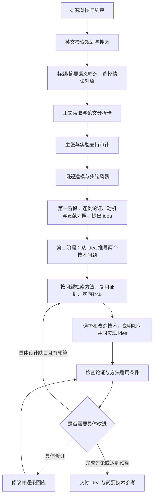

# 架构与当前范围

CLI 使用单进程控制器，SQLite 保存项目状态，文件保存 idea 报告。研究过程与模型后端解耦。

| 模块 | 责任 |
| --- | --- |
| `cli.py` | 命令、项目锁、导入导出、本地 skill 选择 |
| `paper_reading.py` | 有界分块读取、章节/图表清单、九维分析卡、按缺口补读与覆盖记录 |
| `controller.py` | 证据门槛、候选定向补读、对照与可行性状态、迭代、预算、恢复 |
| `prompts.py` / `schema.py` | 有边界的任务规范和本地结构校验 |
| `claims.py` / `novelty.py` / `feasibility.py` / `motivation.py` | 对照证据、操作前提与动机审阅的独立状态规则 |
| `store.py` | 来源、证据、候选版本、任务缓存、事件与 skill 指纹 |
| `literature.py` / `venues.py` / `fulltext.py` | arXiv/OpenAlex/OpenReview、会议元数据过滤、有限全文获取、规范化与去重 |
| `backends/` | Codex、Claude Code、OpenAI-compatible、Anthropic |
| `local_skills.py` / `builtin_skills/` | 加载显式选择的本地文件与八个内置研究 skill，按阶段提供指导 |
| `report.py` | 可读报告和机器可读结果 |

## 控制流程

候选主张保留在 proposal，方法变化保存在 versions。`spec.motivation` 保存当前版本的动机论证，`spec.idea_core` 保存当前核心想法的具体解释；修订同步更新两者，`versions[].revision_record` 记录包括 `idea_core` 在内的逐字段变化。原始问题与核心假设保持锚定，审阅检查是否偷换主张。相似主题不能直接证明重复；源码中的证据检查能够拒绝未知引用、拼接引文和跨论文借用论据，但不能完全判断语义蕴含。

`motivation.existing_work` 说明已有方法实际做到了什么；剩余问题与成因连到 `existing_approach_limit`，再用 `research_need` 推导研究动机，最后提出满足这一需要的 idea。CLI 和主报告将这些字段组合为 Background、Problem、Motivation、Idea 四段连续论证，Idea 正文包含当前 `idea_core` 的四段解释。展示优先读取 `spec.idea_core`，否则读取 `proposal.idea_core`；旧保存内容缺少该对象时沿用原有论证，不补造细节。

技术规划保存在 `candidate.design_search_plan.design_axes`，每个角度记录问题、必要性、所需功能与方法检索方向。查询、来源中的可借鉴技术和最终选择都通过 `axis_ids` 关联这些角度。控制器保证先规划，再检索与选择；关闭网络或达到论文上限时仍规划并复用已读材料。最终 `spec.design_axes` 与 `design_decisions` 共同解释如何实现 idea，同一种技术可以服务两个角度。

## 三项研究约束

每个方法规格同时保留贡献、对照和操作前提，报告 JSON 使用 `schema_version: 7`。

| 结构 | 必须回答的问题 | 尚不能据此确认的结论 |
| --- | --- | --- |
| `proposal.motivation` | 哪个有证据的现象构成问题，为什么重要；现有方法的限制和因果解释是什么；为什么该方法能带来进展；最简单替代方案及方法必要性测试是什么 | 论证完整不代表问题真实重要，也不代表复杂方法优于简单方法 |
| `novelty_claim` | 贡献类型和具体主张是什么；改变了什么变量；可观测后果与证伪条件是什么；为何不是无关紧要的改动 | 主张有表述不代表创新成立或有效 |
| `prior_art.overlaps[].comparisons` | 每篇最近工作在问题、机制、可用信息、目标、评测、核心主张六维上，与候选有什么相同或不同；原文证据在哪里 | 标题相似或某一维相同不代表核心贡献已被覆盖；差异也不自动具有价值 |
| `feasibility.checks` | 数据访问、推理信号、接口、学习信号、计算资源、评测、最小测试七维分别需要什么，如何检查，失败后怎么处理 | 文献支持和可行性审阅不能替代接口检查、数据核验或真实实验 |
| `feasibility.required_signals` | 每项信号用于训练、推理还是评测，当前可用性、获取计划与替代方案是什么 | 评测阶段可见的真实答案不能默认在推理阶段可用 |

`review.motivation_assessment` 将问题意义（`substantial` / `limited` / `unclear`）、因果联系（`plausible` / `unsupported` / `unclear`）、预期进展（`substantive` / `incremental` / `unclear`）分开判断，并给出理由和决定性测试。这些是待核验的审阅判断，用于暴露薄弱动机与不必要的复杂性；系统不能自动判定实质创新或发表价值。

对照中的 `relation` 为 `same`、`different` 或 `unknown`。可行性检查保留 `source_supported`、`unverified`、`blocked`、`not_applicable`；信号可用性保留 `source_supported`、`unverified`、`unavailable`。证据缺口保存在字符串列表 `comparison_gaps`。`feasibility_assessment` 保存 `status`、警告列表 `warnings`、阻塞项 `blocking_checks` 和待核实项 `unverified_checks`；候选的 `feasibility_status` 单独记录。这些诊断保留在 JSON。用户报告以研究问题、意义、核心洞见和贡献为主，第二部分提供技术参考；实验计划不再是必填内容。资料不足可以用 research_hypothesis 提出问题假设；有来源的观察仍要求真实引用。

`focus_sources` 根据候选的 `closest_work_ids` 选择最多三篇已导入且标记为 `full_text` 的来源，以候选假设为上下文执行 `inspect_source`，每篇最多补充六条方法/条件证据。摘要和笔记不会进入该步骤。每次仍由 `source_chars` 限定启发式正文片段；短来源可覆盖全部提供文本，长来源保留 `partial` 标记。因此该步骤增加有方向的证据抽取，不能保证读完全部方法、附录或排除所有既有工作。

## 任务边界

第一阶段的 `map.research_frame` 保存用户的大问题、跨论文归纳的研究主线、由此提出的科学问题，以及具体论文证据与这一问题的联系。它直接传给 `propose`，用于组织通俗的 Background → Problem → Motivation → Idea。研究主线在原有综合步骤内形成，不增加模型调用；来源的具体实验条件仍保留在论文卡、引用和逐项对照中。

`opportunities[].problem_origin` 只有 `unresolved_need`（现有主要方法仍不能解决的重要问题）和 `emerging_problem`（现有方法使用或发展时暴露的新问题）。`opportunity_types` 汇总本次实际采用的来源；`opportunity_id` 将选中的问题与候选相连。`idea_instructions.py` 集中定义第一阶段的完整构思程序，先综合已有路线的目标、信息和共同假设，再推导根本问题、动机与 idea，避免层层叠加重复的审查提示。程序检查结构和引用，研究判断仍由模型结合原文进行。

`propose` 输出的 `idea_core` 用四个短段落保存核心解释：`concrete_target` 指明具体对象及关系或信号，`construction_path` 说明如何从可获得的输入构造并核对这些信息，`capability_bridge` 串起操作、学习或推理要求的改变与预期能力，`essential_difference` 说明与最接近方法正常使用时的关键差异。它与 `intervention` 的操作总述保持一致，随候选传入第二阶段的技术检索和设计。`develop/refine` 继续输出该对象，保留原解释或随修订同步更新。结构校验只检查字段类型和非空内容，缺失时沿用已有的一次修复；不依赖关键词判断科学价值，不增加模型任务或实验协议。

推理上下文保留论文分析、原文证据和条件。`compact_research_context` 将章节/图表目录精简为数量、定位 ID、标题与阅读覆盖，保留后续定向补读所需的信息；大量检索传输记录替换为最近查询的覆盖摘要，原始记录仍在 SQLite 和详细报告。字符数以实际提示词计算并记录在 `model_context` 事件中，不冒充 token 计数或承诺适配任意模型窗口。

`TaskSpec` 包含 task ID、阶段、提示词、输出 schema、工作目录、超时和模型。`BackendResult` 包含 JSON 结果、可获得的用量、会话标识和原始响应。控制器只保存需要的结构化结果和用量，不依赖 CLI 会话恢复。

模型后端用于有边界的推理任务。检索和正文读取在控制器执行；模型输出的工具建议由控制器选择性处理。当前自动补证据包括有预算的学术搜索、公开全文获取，以及对最近工作全文的候选定向补读。失败的全文获取不会提升来源等级；检索覆盖缺口独立保存。代码检查和科学实验建议仅作为 idea 的交接计划；CLI 不提供实验执行或论文写作入口。

API key 读取、请求协议和超时都留在适配器。适配器不把失败转换成 demo，不把 refusal 或截断结果当成有效 JSON。每个原生协议的结构化输出要求可能随服务变化，应通过真实账户做兼容性验证。

模型操作错误由适配器分类为 `ProviderError`，仅输出固定的错误类别和处理建议，原始错误正文不进入日志。研究与普通对话共用 `with_retries`：首次失败后等待 30 秒，最多再尝试 10 次。API 适配器自身只发一次请求，避免重试叠加。每次调用重新检查预算和剩余超时；失败尝试和等待时间也累计。输出/证据校验继续使用原有的一次修复，不进入服务重试循环。

## 状态与恢复

`output_dir` 只配置结果的父目录，默认定位源码仓库；每个项目在 SQLite 中保存一个 `idea-时间戳` 文件夹名。恢复和重复导出沿用该名字，`last_output_dir` 记录最后成功导出的完整位置供 `/report` 读取。修改保存位置不改变研究任务缓存；旧报告保留，新项目生成新名字。

- 任务：running / succeeded / failed。成功结果使用输入与后端配置散列缓存。
- 项目：initialized / sources_changed / running / interrupted / completed / budget_exhausted / blocked。
- 候选：proposed / specified_for_test / prerequisites_unverified / motivation_unresolved / needs_revision / implementation_blocked / round_limit_reached / overlap_requires_confirmation / no_detectable_progress。
- 操作前提：`feasibility_status` 为 `prerequisites_unverified`（前提待核实）、`blocked`（前提阻塞）或 `specified_not_executed`（规格明确但未执行）；逐项依据另存，不能把流程完成当成实施已验证。
- 实验证据：初始 untested；系统只输出验证计划，不执行科学实验。

completed 表示这一轮软件工作结束，不表示 idea 已验证或具备发表价值。

Ctrl+C 将项目记为 interrupted；未完成任务保留可重试的中断记录，已经保存成功的结果继续缓存。恢复时先将上次异常退出留下的 running 任务记为中断，避免旧任务长期显示为正在执行；调用与时间用量继续累计。

候选批次在初次生成后冻结；内部补充证据不删除已有候选。显式导入、更换约束、用户对话补充或重新规划可以建立新批次，并归档旧批次。方法草稿在候选补查前保存，补查中断后用 `pending_round` 接着当前草稿；若全文升级使引用失效，则先更新来源引用。成功审阅后追加讨论记录，遇到预算中断可以续跑。项目文件锁防止两个控制器同时修改一个项目。`status` / `inspect` 通过 SQLite URI `mode=ro` 和 WAL 事务快照查看运行中的项目，不占用写入锁。

## 检索范围

`search_scope.py` 统一校验日期窗口、会议时间策略、CS 字段要求与 arXiv 分类。`conference_policy=latest` 默认按每个会议最新公开或收录的一届检索，本届尚无公开论文时采用上一届，不受 arXiv 日期窗口的起点限制；截止日期仍保留。`window` 则让会议也遵循日期窗口。显式选择固定日期时默认切到 `window`，可再次显式选择 `latest`。查询阶段和返回记录阶段分别检查范围；日期、会议策略、分类、会议和实际查询表达式进入检索缓存身份。arXiv 保留首次提交日期与交叉分类，OpenAlex 保留发表日期和计算机字段元数据，COLM 使用已录用 venue ID 和原始发布时间/创建时间。元数据缺失不被当成范围已满足。

届次选择先于主题检索。ACL、EMNLP、NAACL、ICML、ICLR、NeurIPS、COLM 优先读取官方目录；本届已有论文但与查询无关，不会因此改选旧届。其他会议或未取到的目录使用已核实的 OpenAlex 来源：优先采用来源名称中的明确届次，连续出版系列采用收录年份，并保存判断依据。最多查看当前及前两个年份，以覆盖年度和隔年会议。会议届次单独保存，预印本的首次发布时间不会覆盖它。

`hybrid` 先取已核实的会议来源，再在剩余预算内补充 arXiv 预印本。一次请求的全部提供方共享期限；会议失败时保留具体缺口，arXiv 补充仍使用其原有日期和领域限制。结果用既有 DOI/arXiv 去重逻辑合并。旧语料和显式导入不被自动删除，报告将当前联网范围与已有上下文区分开。

最新届次模式的单次会议检索上限为 120 秒，其他模式为 60 秒，均受剩余项目预算限制。较大的官方年度目录在首次下载后进入项目的 24 小时 URL 缓存，后续主题查询复用目录。在相关度相近的论文中，排序优先较新会议届次；模型选文和贡献对照也使用这一顺序。

语义选文前，`paper_metadata.py` 为排名靠前但缺摘要的会议候选读取单篇论文介绍页，最多六页、总计十二秒，不下载全文或增加模型调用。补齐的摘要保存到检索记录供恢复使用；最终仍按研究相关性选择少量论文精读。CLI 显示已核实的会议与届次，即使全文来自 arXiv 也保留会议身份。

Codex 的临时 `error` 事件可能表示正在重连。适配器仅在其后出现 `turn.completed` 时接受已恢复的结构化结果；`turn.failed`、缺少成功终止事件或成功之后仍有错误的结果仍被拒绝。

## 需要继续完成的能力

1. 验证章节识别与定向补读是否减少关键方法、实验和附录遗漏。
2. 使用固定真实文献集比较直接提示、普通 RAG 和本系统的质量。
3. 评估最小验证计划是否真正区分核心机制和简单替代解释。
4. 真实模型与本地 CLI 兼容性联调。
5. 需要时添加批量并发和更多文献源；当前不需要分布式 agent 平台。

## 本地 skill 与可复现性

内置八个 skill 随包发布，默认启用；外部 skill 只按明确选择加载。`local_skills.py` 对已知研究 skill 按阶段分配；未知的用户自定义 skill 作为所有阶段的显式补充，用户应保持其范围简洁。相同名称的不同路径不会自动覆盖。

控制器在一次运行开始时读取并冻结 skill 文本，提示词只携带当前阶段相关内容。文件 SHA-256 进入任务缓存，完整选择进入候选批次与方法版本的散列。报告保留实际使用清单；指纹说明加载了哪个版本，不证明模型完全遵循或研究效果更好。

本地 Codex executable 和 profile 进入执行身份。Codex 自己负责现有登录与用户配置，本程序不复制认证文件。当前边界保持受限推理，skill 的脚本与外部工具需要另行实现，不能由文本指导暗中启动。

普通证据抽取会替换此前同来源的普通解释；空结果也生效。定向阅读记录来源散列、阶段指导指纹与候选范围，只有来源和指导仍一致的记录才会保留。修改 skill 后不能仅因论文文本没变，就继续沿用已经撤回的抽取结论。

## 主张审计与检索规划

`plan_search` 将中文/英文意图转成最多三条英文关键词查询，包含目的与理由；`search_planning.py` 校验结构、长度、重复和容量，计划不是检索证据。初始检索保留约一半文献容量用于候选后的机制定向查询，所有调用计入统一预算。

`audit_claims` 每篇全文最多审计四项主张，保存作者主张、测试范围、结果证据、可支持结论、限制、混杂、缺少的对照和下一步阅读。`claims.py` 重新检查同篇来源哈希和引文位置；摘要、作者主张、无实验条件的引用不能算实验证据。不支持的判断降为 `insufficient_evidence`。结果的来源分类和语义支持仍由模型判断，因此不能把结构校验当作科学证明。

六维 novelty gate 的 `covered` 还要求 evaluation 对照引用同篇全文 `reported_result`。这是保守的实证研究筛选门槛；理论性主张仍可能需要人工核查，证据不足不会证明机制新颖。

`versions[].revision_record` 保存原始问题/假设/预测、上轮质疑、逐字段变化、新证据和当前未解决问题。仅内容精确重复、证据未变且仍要求修订时返回 `no_detectable_progress`。文字改写仍可能算变化；程序没有声称能机械判定语义进步。

## 有界论文分析

`read_section` 对连续原文片段提取最多六条带精确位置的证据。默认优先读取引言、方法、实验等章节附近的最多三片，每片最多 `source_chars` 字符。机械库存检测章节、图表标题和公式编号；检测不保证穷尽，图片未被视觉检查。

`paper_card` 仅据当前同篇原文证据生成九个固定维度，按论文类型允许证据不足或不适用：

| 维度 | 要回答的问题 |
| --- | --- |
| problem | 什么具体问题、在什么条件下出现？ |
| motivation | 为什么重要，已有办法为什么不足？ |
| insight | 核心解释或假设是什么？ |
| method | 输入输出、信息流、模块必要性是什么？ |
| prior_work_delta | 作者声称改了什么，哪些差异尚未独立核查？ |
| experiment_design | 测试哪个主张，基线与控制条件是什么？ |
| results | 实际报告了什么，是否存在混杂？ |
| conclusion_boundary | 能支持多强的结论，哪些范围未测试？ |
| idea_relevance | 对当前问题有什么启发，如何证伪？ |

细节列表区分核心模块、实验—主张链、作者局限、分析疑点和研究机会。模型提出最多三个具体阅读问题，必须引用已有章节或图表 ID；控制器默认最多补读两片未读文本，再综合一次，之后保留未解决问题。不执行无限阅读、代码检查或实验。

读取后新增证据会使旧分析卡失效；来源和 skill 变化会改变缓存身份。预算中断时，报告只展示已完成的阅读范围与当前有效分析，恢复时复用成功任务。全部文本提供给模型也不等于全面理解；图表标题的文本覆盖不等于视觉验证。

主报告先展示 idea 与简要技术参考，完整论证与原文依据折叠展示。分析卡是内部推理与按需核查材料，不是增加用户操作步骤的目标。

## 构思与交流契约

当前可读流程和角色交接详见 [workflow.md](workflow.md)。方法规格增加 `review_responses`，每条包含 `issue`、`decision`、`change`、`reason` 与 `evidence_ids`，refine 必须逐条回应上一轮意见。允许有理由地不采纳意见，不通过角色数量决定质量。`motivation.basis` 区分来源观察和问题假设；来源观察仍需引用。`dialogue` 与版本记录同时保存。

`map.opportunities` 保存不同研究问题及其文献推导、洞见、意义、已有工作差异和可行依据。`propose` 接收完整问题分析，用 `opportunity_id` 指向主切口，用 `selection_reason` 说明科学选择。切口 ID 必须存在且唯一，来源观察必须带有效引用；问题假设可以没有引用。报告 JSON 保留这些记录，CLI 默认显示可读摘要，旧项目没有新字段时仍能导出。没有按词项相似度或自评分自动淘汰的逻辑。

提示词按阶段版本缓存。阅读和引用流程未变时，构思流程更新不会重新消耗全文读取调用；方法生成后先检查点保存，审阅中断后复用原任务输入恢复。
