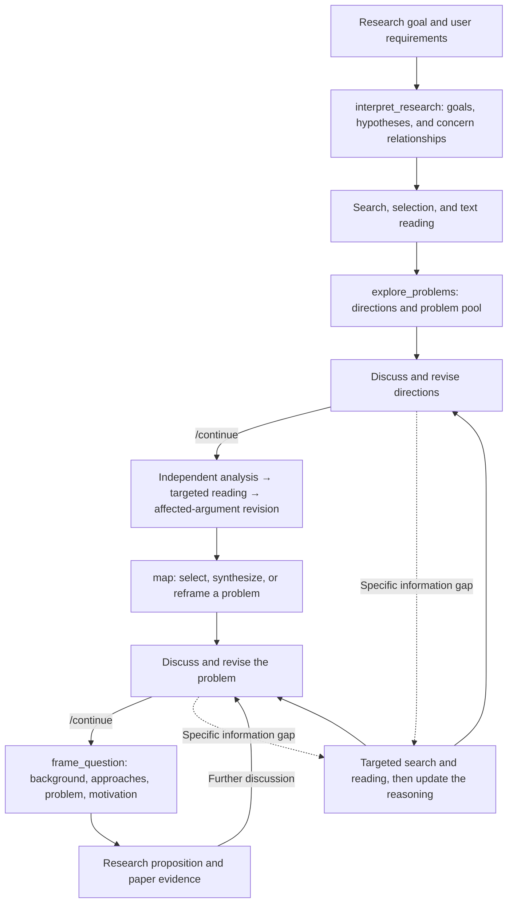

# Architecture and current scope · v1.0.0

**English** | 

The Python CLI coordinates search, reading, problem analysis, and discussion. SQLite stores project and conversation state; models perform bounded, structured tasks. The product ends with the background, existing approaches, problem, and motivation, rather than automatically developing a solution.

## Modules

| Module | Responsibility |
| --- | --- |
| `cli.py` / `chat.py` / `chat_worker.py` | Batch and interactive interfaces, isolated workers, commands, and event presentation |
| `question_workflow.py` | Main workflow, two discussion checkpoints, confirmation, recovery, and final research proposition |
| `problem_discovery.py` | Direction exploration, independent analysis, and comparison handoffs |
| `problem_dialogue.py` | Direction/problem discussion, incremental revision, atomic conversation and research-version commits |
| `discussion_sources.py` | Bounded search and follow-up reading for specific questions, saved selections, and recovery |
| `focused_reading.py` | Passage selection prioritizing the current question and explicit identifiers; contiguous text and locations |
| `research_context.py` | Source views, compact run records, and reversible deduplication of model inputs |
| `conversation.py` | Original history, active requirements, earlier-message retrieval, stage scope, and migration |
| `memory_scope.py` | Correcting the lifetime of local presentation requirements from the user's original words, including older conversations |
| `discussion_focus.py` | Validation, display, and continuation of one optional follow-up question, separate from user decisions |
| `discussion_changes.py` | Comparing committed drafts and notes to display actual changes |
| `controller.py` | Source and model tasks, structure/citation validation, caching, and budgets |
| `paper_reading.py` / `claims.py` | Chunked reading, nine-dimension paper cards, and connections between author claims and results |
| `literature.py` / `venues.py` / `fulltext.py` | Academic indexes, conference sources, public full-text retrieval, and deduplication |
| `schema.py` / `prompts.py` / `local_skills.py` | Task schemas, research guidance, and task-specific skill loading |
| `store.py` / `report.py` / `presentation.py` | Persistence, Markdown/JSON export, and readable presentation |
| `backends/` | Codex, Claude Code, OpenAI-compatible, and Anthropic adapters |

## Main workflow

`make_prompt` calls `compact_task_payload` only during problem discovery, discussion, and final framing. Long research records that are exactly identical share backward JSON pointer references. This does not summarize their meaning or truncate them by length; different conditions are not merged. Evidence and conversation memory remain inline. Storage, cache fingerprints, validators, and reports use the complete original payload; model output must retain the original complete structure. `expand_task_payload` verifies reconstruction for offline backends and tests without additional live model calls. This reduces duplication but does not guarantee that arbitrarily large evidence collections fit a model's context window.

Follow-up reading uses this turn's question for the corresponding paper, falling back to the original selection question only when there is no new one. Quoted search phrases remain intact. Explicit identifiers prioritize algorithm, section, figure, or table headings in the main text or appendices, followed by nearby passages and keyword windows. Selection remains bounded by `source_chars` and excludes bibliography entries. The locator version participates in the reading cache key so old selections are not reused. Quote validation remains restricted to the contiguous source windows actually supplied.

`Controller.run_questions` is the current CLI entry point. Older solution-generation functions and data structures remain for historical projects and compatibility reads. Current commands do not execute the `propose/develop/refine/review` method loop.

Supplementary sources for every problem are acquired before independent analysis begins. Each analysis receives the other problem seeds from the same round and the relationships among user concerns, but not other candidates' priority judgments. `map` compares their value while retaining the original analyses. `frame_question` reads the current discussion version and outputs `title/background/existing_methods/problem/motivation/research_claim/why_priority`, together with paper and evidence IDs. There are no method or experiment fields.

## Conversation transactions and memory

The user's original message is stored before a model call. `memory_updates` may cite only user messages actually supplied to the model. Updates support add/replace/remove, retaining inactive records and replacement relationships. The assistant reply, research version, memory, and successful-processing marker are committed together through `Store.set_many`.

Memory scopes are `turn`, `discussion`, and `research`. Length or formatting instructions for one reply default to `turn`; explicit lasting preferences and final-report requirements remain active. Local corrections affect presentation requirements only and check the source wording so a lasting research constraint in the same sentence is not accidentally shortened. `finish_turn` ends turn-scoped requirements on successful commit and marks them as used only for that turn in `last_turn_changes`. Older conversations receive the same correction when read, persisted on the next successful save; original messages remain unchanged. Expired records retain provenance but are excluded from `research_notes`.

`finish_turn` also computes and saves `last_turn_changes`: actual data differences in background, approach synthesis, problems and selections, note replacements, and discussion reasoning. It does not infer changes from the wording of the assistant reply. The worker emits an `update` event after commit; `/memory` can display the complete account. A reply without structured changes does not overwrite the problem draft.

Source follow-up is separately resumable work: plans, selected papers, and actual reading records are saved before generating the discussion reply. If the final model reply fails, the message remains pending; resending identical text reuses its original ID. Different new messages are retained as additional corrections without deleting earlier wording. Memory suggestions made before follow-up reading take effect only when the final post-reading reply commits.

History is not the same as current requirements. Model context combines active notes, source messages, recent messages, pending user messages, and relevant earlier content. Replaced requirements remain explicitly inactive. All original wording stays in SQLite; retrieval views can be bounded.

History retrieval uses three kinds of clues: this turn's query, the current problem, and the latest assistant reply. Direct matches take priority; other results alternate into the remaining slots, up to six user messages. Current-problem and assistant clues are each limited to 1,200 characters. Relevant clues locate contiguous excerpts in long messages without altering the originals. `retrieval_hints` identifies each clue's source; assistant clues are not added to the citable user-message set. Manual history searches do not expand implicitly.

`discussion_key` identifies a stage instance, while `kind` distinguishes direction and problem discussion; revision changes do not change the instance. `/continue` ends temporary requirements for the current instance only. Before replacing a checkpoint, older notes migrate to their original stage so temporary requirements do not leak into a new discussion.

## Research and source state

- Project states include `awaiting_direction_discussion`, `awaiting_problem_discussion`, `running`, `completed`, `interrupted`, `budget_exhausted`, and `blocked`.
- Checkpoints store `kind/state/revision/original/current/revisions/source_key/confirmed_revision`.
- `question_cycle` stores the step and interaction mode; `question_brief_provenance` records the version, confirmation source, and cache identifier used to frame the final text.
- User changes to sources or research scope invalidate and reopen discussion. Sources added by the controller's own follow-up remain within the same stage. Changing model or effort preserves selections but affects subsequent task caching.
- New reports use `schema_version: 18`, containing the current research proposition, problem analyses, search records, complete conversation, and memory. The new workflow does not mix in old technical proposals.

Citation validation checks IDs, source locations, paper ownership, and actual quotations. Paper cards distinguish author claims, results, and analysis. Models may boldly infer new difficulties, but must not present those inferences as results already proved by a paper. No additional scientific scoring or publication-guarantee gate is imposed.

## Budgets and recovery

`max_papers` controls initial reading slots; targeted work for a specific problem or discussion turn selects at most two papers. All work shares the project's call and runtime budgets. Text windows are additionally bounded by `source_chars` and chunk/follow-up limits. Successful calls are cached and failed tasks can resume. Waiting for user input does not consume runtime.

Model-service errors are categorized and retried after 30 seconds, up to ten retries; each attempt checks the remaining budget. Structure or citation errors receive one targeted output-repair attempt. Backends handle authentication and API requests; the application does not copy CLI credentials.

Results go into a stable `idea-TIMESTAMP` folder under a configurable parent directory. Markdown serves readers; JSON retains the complete reasoning and sources. Changing report scope does not delete original papers, historical project records, or user conversations.

## v0.7.0: research intent and problem formulation

Before a new research project's first search, `research_intent.py` adds one `interpret_research` call and stores `mode/goal/goal_sources/concerns/relationships/interpretation`. Source references are checked against user wording. Relationships are model interpretations, not verified causal facts. Broad exploration may have no specific concerns; existing ideas distinguish goals from hypotheses. Search planning, problem follow-up reading, independent analysis, reconsideration, comparison, and final framing all receive this state. Analysis tasks also receive the other problem seeds from the round.

`map.formulation` supports select, synthesize, and reframe. Member IDs point to analyzed cases; synthesis or reframing uses a separate ID and does not overwrite the originals. The program validates references, member links, concern coverage, and required fields while allowing revised hypotheses and adjusted scope; it does not assign scientific scores. The current problem and priority selection are published to the CLI only after formulation updates them, together with relationship judgments and the reason for focusing.

`updated_intent` commits atomically with the discussion draft, original messages, and memory. `research_intent_history` retains before/after versions and message provenance. Temporary formatting belongs to turn memory, not research intent. A changed problem or goal clears the old formulation; final framing reconstructs the relationships from the current discussion and full intent. Resuming an existing pause does not rerun intake or automatically change topics. New research and replanning establish intent when it is missing. Task inputs and framing caches include intent; source texts and reading results remain reusable. Report JSON exports intent and revision history; `/memory` shows the current interpretation and original user wording.

## Paper understanding in targeted reading

Full-text reading with `phase=problem` uses `read_problem_source` instead of the former excerpt-only `inspect_source`, within the same model call. `source_understanding.py` converts `reading_points.observation_indices` into validated evidence IDs and records the operating principle, input sources, actual process, and effect on the research question. Author claims, the paper's accounts of prior work, inferences, and conjectures have separate types. Method, theory, and analysis papers are explained according to their actual content; no algorithm template must be filled artificially.

Quotes still undergo source-location validation with one repair attempt. If the second attempt also fails, invalid quotations and every understanding point that depends on them are removed, and remaining indices are remapped. Existing explanations are never silently reattached to different evidence. Duplicate excerpts map to the same evidence by content so deduplication cannot misalign citations. Scientific correctness still requires research judgment; structural validation checks sources and handoffs.

`source_understandings` stores complete targeted-reading records. `ideation_context` reserves up to 12,000 characters for this added material, measured as serialized JSON characters rather than presented as a token limit. It selects up to 12 currently valid understandings, prioritizing different papers before additional readings of the same paper. Whole explanation points are selected across sources in turn, prioritizing research implications, core intuition, and information sources, without cutting sentences or conditions. Coverage records show available and included counts. Full records stay local; original evidence and user goals continue through their existing paths. When source versions, reading guidance, or research intent changes, old explanations remain historical but no longer represent current judgments; removing evidence also stops the associated record from being passed forward. Problem-reading caches include the new guidance and intent. Background orientation remains lightweight; no automatic extra reading rounds are added. JSON exports full records; the CLI presents implications, intuition, information sources, and processes with paper links.

When the user changes the goal and requests reading in the same turn, the new goal becomes temporary reading context and participates in cache keys and explanation ownership. The post-reading reply receives this temporary goal, the unchanged persistent goal, and new explanations. The goal change commits only after the final reply succeeds. Retries reuse completed reading without interpreting new explanations under the old goal. Other payload paths for reading and reconsideration retain only sources and progress; explanations pass once through the common bounded view to avoid duplicate injection outside its size budget.

The optional follow-up question is stored in `checkpoint.discussion_focus`, attributed to the assistant and linked to the message it answers. It commits with the successful reply, problem revision, and memory. The next model turn receives only the current question, not an accumulating question list. No follow-up or `/continue` clears it; the complete conversation remains searchable. Older checkpoints and completed but uncommitted replies without the field treat it as empty. See [multi-turn discussion evaluation](discussion-evaluation.md).

## Argument-driven source acquisition

After direction confirmation, `problem_discovery.py` freezes starting material and independently develops each candidate. `discussion_sources.py` receives the complete `problem_analysis`; source selection also carries causes, derivation, and goal impact. One `reconsider_problems` call considers new readings across candidates and returns complete `case_updates` only for affected arguments. Unchanged analyses are reused by the controller. Missing analyses for new/changed directions, invalid IDs, or unrecorded changes use the existing output-repair path; these are structural checks, not scientific scores or title-based vetoes. `problem_development` persists starting inputs, analyses, and reading progress, with a separate fixed revision context. Before/after analyses are included in reports.
