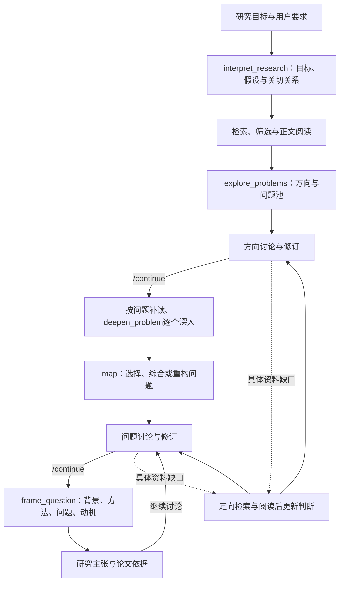

# 架构与当前范围 · v0.7.0

Python CLI 组织检索、阅读、问题分析和讨论。SQLite 保存项目及会话状态；模型只完成有界的结构化任务。产品以背景、现有方法、问题和动机为终点，不自动生成解决方案。

## 模块

| 模块 | 职责 |
| --- | --- |
| `cli.py` / `chat.py` / `chat_worker.py` | 批处理与交互窗口、独立任务进程、命令及事件显示 |
| `question_workflow.py` | 当前主流程、两处讨论暂停、确认与恢复、最终研究主张 |
| `problem_discovery.py` | 方向探索、独立深入与比较交接 |
| `problem_dialogue.py` | 方向/问题讨论、增量修订、原子保存对话与研究版本 |
| `discussion_sources.py` | 具体问题触发的有界检索/补读、选择记录与恢复 |
| `conversation.py` | 原始历史、有效要求、旧消息检索、阶段作用域与迁移 |
| `memory_scope.py` | 根据用户原话校正局部表达要求的期限，兼容旧会话 |
| `discussion_changes.py` | 对比成功保存前后的讨论稿和要点，生成可查看的实际修改提示 |
| `controller.py` | 来源与模型任务、结构/引用校验、缓存、预算 |
| `paper_reading.py` / `claims.py` | 分块阅读、九维论文卡、作者主张和结果的联系 |
| `literature.py` / `venues.py` / `fulltext.py` | 学术索引、会议来源、公开全文获取及去重 |
| `schema.py` / `prompts.py` / `local_skills.py` | 任务输出结构、研究规范及按任务加载的 skill |
| `store.py` / `report.py` / `presentation.py` | 持久化、Markdown/JSON 和可读显示 |
| `backends/` | Codex、Claude Code、OpenAI-compatible、Anthropic 适配器 |

## 当前主流程

`Controller.run_questions` 是 CLI 当前入口。旧版本的方案生成函数和数据结构保留供历史项目及兼容读取，当前命令不执行 `propose/develop/refine/review` 方法循环。

所有问题所需补充来源先获得，再逐个深入；每次深入保留同轮其他问题种子与用户关切关系，不带其他候选的优先级判断。`map` 比较各自价值，保留已深入的原论证。`frame_question` 读取当前讨论版本，输出 `title/background/existing_methods/problem/motivation/research_claim/why_priority` 以及论文、证据 ID，不包含方法或实验字段。

## 对话事务与记忆

用户原话先入库，再调用模型。讨论结果中的 `memory_updates` 只允许引用实际提供给模型的用户消息。更新支持 add/replace/remove；保留失效记录和替代关系。助手答复、研究版本、记忆和处理成功标记通过 `Store.set_many` 一起提交。

记忆作用域包括 `turn`、`discussion`、`research`。单次答复的字数、格式等要求默认 `turn`；明确的长期偏好和最终报告要求继续保留。局部校正只处理表达要求，并核对对应原话，避免同一句中的长期研究约束被一起改短。`finish_turn` 在成功提交时结束本轮要求，`last_turn_changes` 标为仅本轮采用。读取旧会话时应用相同校正，下一次成功保存时写回；原始消息不变。过期记录保留出处，但不加入 `research_notes`。

`finish_turn` 同时计算并保存 `last_turn_changes`：根据实际数据比较背景、方法梳理、问题与选择、要点替换及讨论理由，不读取模型答复来推断修改。工作进程在提交后输出 `update` 事件，完整说明可由 `/memory` 重读。没有结构化修改的答复不改写问题稿。

来源补查是单独的可恢复工作：计划、选中论文、实际阅读记录保存后再生成讨论答复。最终模型回复失败时，消息仍是 pending；重发同文本复用原 ID。不同新消息保留为追加纠正，不删除旧原话。补查前的记忆建议不提前生效，由补查后的最终答复统一提交。

历史不等于当前要求。模型上下文组合现行要点、出处原话、近期消息、待处理用户消息与查询相关的早期内容；被替换的旧要求显式保持失效。所有原话仍在 SQLite，检索视图可以有界。

历史召回使用本轮查询、当前问题和最近助手回复三类线索。直接匹配优先，其他结果交替填充剩余名额，最多补入 6 条用户原话；当前问题和助手线索各最多 1200 字符。长消息的连续节选按相关线索定位，原文不修改。`retrieval_hints` 明确来源，助手线索不加入可引用的用户消息集合；手动历史搜索不做隐式扩展。

`discussion_key` 绑定阶段实例，`kind` 区分方向和问题；修订号变化不改变实例。`/continue` 只结束当前实例的临时要求。更换 checkpoint 前先迁移旧要点的阶段归属，避免把旧临时要求带入新阶段。

## 研究与来源状态

- 项目状态包含 `awaiting_direction_discussion`、`awaiting_problem_discussion`、`running`、`completed`、`interrupted`、`budget_exhausted`、`blocked`。
- checkpoint 保存 `kind/state/revision/original/current/revisions/source_key/confirmed_revision`。
- `question_cycle` 保存步骤及互动模式；`question_brief_provenance` 记录整理正文使用的版本、确认来源与缓存标识。
- 用户更改来源或研究范围使讨论失效并重开；控制器自己补查的来源更新保留在同一阶段。模型/思考强度更改保留选择，但影响后续任务缓存。
- 新报告使用 `schema_version: 17`，包含当前研究主张、问题分析、检索记录、完整会话和记忆。新流程不混入旧技术方案。

引用校验检查 ID、原文位置、论文归属和实际引文；论文卡区分作者主张、结果及分析。模型可大胆推演新的困难，但不得把推演写成论文已经证明的结果。没有额外科学打分或发表保证门槛。

## 预算与恢复

初读名额由 `max_papers` 控制；每个具体问题或讨论轮的定向工作最多选两篇。共享项目模型调用/时间预算，正文片段另受 `source_chars` 和分块/补读次数限制。成功调用缓存，失败任务可恢复；窗口等待输入不累计运行时间。

模型服务错误按类别提示，30 秒后重试，最多重试 10 次；每次先检查剩余预算。结构或引用错误仅进行一次有针对性的输出修复。认证和 API 请求由后端负责，应用不复制 CLI 凭据。

结果保存到可配置父目录下固定的 `idea-时间戳` 文件夹，Markdown 面向读者，JSON 保留完整推导及来源。原始论文、旧项目记录与用户对话不会因更改报告范围被删除。

## v0.7.0 研究主线与问题表述

`research_intent.py` 在新研究的检索前增加一次 `interpret_research`，保存 `mode/goal/goal_sources/concerns/relationships/interpretation`。来源引用核对用户原话，关系是模型解读，不当作已经验证的因果。宽方向允许无具体关切；已有想法区分目标与假设。检索规划、问题补读、逐个深入、重新构思、比较和最终表达都收到这份状态；深入任务还收到同轮其他问题种子。

`map.formulation` 支持 select、synthesize、reframe；成员 ID 指向已深入的案例，综合或重构使用独立 ID，原案例不覆盖。程序校验引用、成员链接、关切覆盖和必要字段，允许假设被修订、范围被调整，不判科学得分。当前问题与优先选择由 formulation 更新后才向 CLI 发布；关系判断与聚焦理由一并展示。

`updated_intent` 随讨论稿、原话与记忆原子提交，`research_intent_history` 保存前后版本及消息出处。临时格式要求留在 turn 记忆，不写入研究主线。讨论改了问题或目标就清除旧 formulation，最终整理用当前讨论版本和完整研究主线重新梳理关系。恢复已有暂停不会重跑 intake 或自动改选题；新研究及重新规划在缺少主线状态时建立它。任务输入与最终整理缓存包含研究主线，论文原文与阅读结果继续复用。报告 JSON 导出主线和修订历史，`/memory` 显示当前理解与用户原话。
