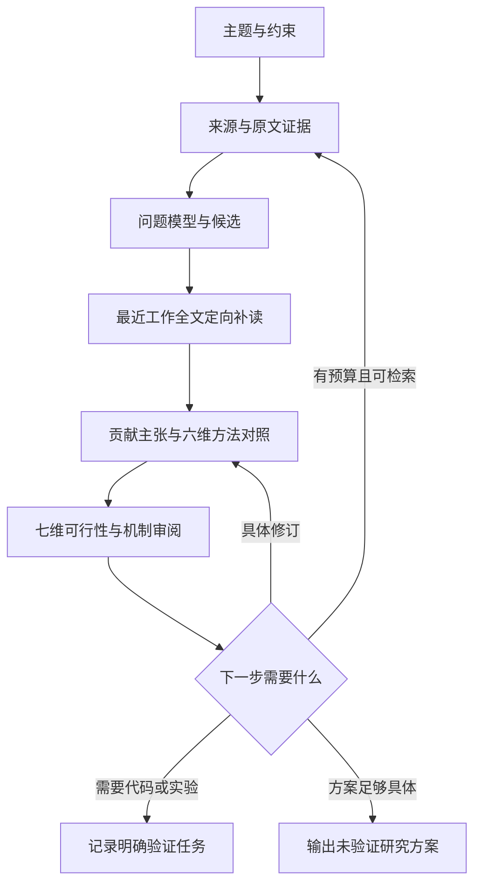

# 架构与当前范围

CLI 使用单进程控制器，SQLite 保存项目状态，文件保存报告和实验日志。研究过程与模型后端解耦。

| 模块 | 责任 |
| --- | --- |
| `cli.py` | 命令、项目锁、导入导出、显式实验入口 |
| `controller.py` | 证据门槛、候选定向补读、对照与可行性状态、迭代、预算、恢复 |
| `prompts.py` / `schema.py` | 有边界的任务规范和本地结构校验 |
| `novelty.py` / `feasibility.py` / `motivation.py` | 对照证据、操作前提与动机审阅的独立状态规则 |
| `store.py` | 来源、证据、候选版本、任务缓存、事件与实验 |
| `literature.py` | arXiv/OpenAlex、规范化、去重、本地正文读取 |
| `backends/` | Codex、Claude Code、OpenAI-compatible、Anthropic |
| `experiments.py` | 用户显式提供的本地实验规格执行 |
| `report.py` | 可读报告和机器可读结果 |

## 控制流程

候选主张保留在 proposal，方法变化保存在 versions。`spec.motivation` 保存当前版本的动机论证，允许修订解释和必要性检验；原始问题与核心假设保持锚定，审阅检查是否偷换主张。相似主题不能直接证明重复；源码中的证据检查能够拒绝未知引用、拼接引文和跨论文借用论据，但不能完全判断语义蕴含。

## 三项研究约束

每个方法规格同时保留贡献、对照和操作前提，报告 JSON 使用 `schema_version: 2`。

| 结构 | 必须回答的问题 | 尚不能据此确认的结论 |
| --- | --- | --- |
| `proposal.motivation` | 哪个有证据的现象构成问题，为什么重要；现有方法的限制和因果解释是什么；为什么该方法能带来进展；最简单替代方案及方法必要性测试是什么 | 论证完整不代表问题真实重要，也不代表复杂方法优于简单方法 |
| `novelty_claim` | 贡献类型和具体主张是什么；改变了什么变量；可观测后果与证伪条件是什么；为何不是无关紧要的改动 | 主张有表述不代表创新成立或有效 |
| `prior_art.overlaps[].comparisons` | 每篇最近工作在问题、机制、可用信息、目标、评测、核心主张六维上，与候选有什么相同或不同；原文证据在哪里 | 标题相似或某一维相同不代表核心贡献已被覆盖；差异也不自动具有价值 |
| `feasibility.checks` | 数据访问、推理信号、接口、学习信号、计算资源、评测、最小测试七维分别需要什么，如何检查，失败后怎么处理 | 文献支持和可行性审阅不能替代接口检查、数据核验或真实实验 |
| `feasibility.required_signals` | 每项信号用于训练、推理还是评测，当前可用性、获取计划与替代方案是什么 | 评测阶段可见的真实答案不能默认在推理阶段可用 |

`review.motivation_assessment` 将问题意义（`substantial` / `limited` / `unclear`）、因果联系（`plausible` / `unsupported` / `unclear`）、预期进展（`substantive` / `incremental` / `unclear`）分开判断，并给出理由和决定性测试。这些是待核验的审阅判断，用于暴露薄弱动机与不必要的复杂性；系统不能自动判定实质创新或发表价值。

对照中的 `relation` 为 `same`、`different` 或 `unknown`。可行性检查保留 `source_supported`、`unverified`、`blocked`、`not_applicable`；信号可用性保留 `source_supported`、`unverified`、`unavailable`。证据缺口保存在字符串列表 `comparison_gaps`。`feasibility_assessment` 保存 `status`、警告列表 `warnings`、阻塞项 `blocking_checks` 和待核实项 `unverified_checks`；候选的 `feasibility_status` 单独记录。报告显式展示待核实（pending）或阻塞（blocked）的前提，有此类项时优先显示 `recommended_action`，再使用审阅的 `next_action`。

`focus_sources` 根据候选的 `closest_work_ids` 选择最多三篇已导入且标记为 `full_text` 的来源，以候选假设为上下文执行 `inspect_source`，每篇最多补充六条方法/条件证据。摘要和笔记不会进入该步骤。每次仍由 `source_chars` 限定启发式正文片段；短来源可覆盖全部提供文本，长来源保留 `partial` 标记。因此该步骤增加有方向的证据抽取，不能保证读完全部方法、附录或排除所有既有工作。

## 任务边界

`TaskSpec` 包含 task ID、阶段、提示词、输出 schema、工作目录、超时和模型。`BackendResult` 包含 JSON 结果、可获得的用量、会话标识和原始响应。控制器只保存需要的结构化结果和用量，不依赖 CLI 会话恢复。

模型后端用于有边界的推理任务。检索和正文读取在控制器执行；模型输出的工具建议由控制器选择性处理。当前自动补证据包括有预算的学术搜索，以及对已导入最近工作全文的候选定向补读。代码检查和科学实验建议保留为下一步动作，不会未经用户显式执行命令启动。

API key 读取、请求协议和超时都留在适配器。适配器不把失败转换成 demo，不把 refusal 或截断结果当成有效 JSON。每个原生协议的结构化输出要求可能随服务变化，应通过真实账户做兼容性验证。

## 状态与恢复

- 任务：running / succeeded / failed。成功结果使用输入与后端配置散列缓存。
- 项目：initialized / sources_changed / running / completed / budget_exhausted / blocked。
- 候选：proposed / specified_for_test / prerequisites_unverified / motivation_unresolved / needs_revision / implementation_blocked / round_limit_reached / overlap_requires_confirmation。
- 操作前提：`feasibility_status` 为 `prerequisites_unverified`（前提待核实）、`blocked`（前提阻塞）或 `specified_not_executed`（规格明确但未执行）；逐项依据另存，不能把流程完成当成实施已验证。
- 实验证据：初始 untested；独立实验执行记录保持 unreviewed。

completed 表示这一轮软件工作结束，不表示 idea 已验证或具备发表价值。

候选批次在初次生成后冻结；内部补充证据不删除已有候选。显式导入、更换约束或重新规划可以建立新批次，并归档旧批次。每个方法版本在审阅后保存，遇到预算中断可以续跑。项目文件锁防止两个控制器同时修改一个项目。

## 需要继续完成的能力

1. 在现有候选定向补读上增加逐节定位、附录读取和全文覆盖审计，减少启发式片段遗漏。
2. 使用固定真实文献集比较直接提示、普通 RAG 和本系统的质量。
3. 将真实实验结果以审阅任务回写主张，保留相反解释和统计不确定性。
4. 真实模型/CLI/GPU 环境联调。
5. 需要时添加批量并发和更多文献源；当前不需要分布式 agent 平台。
